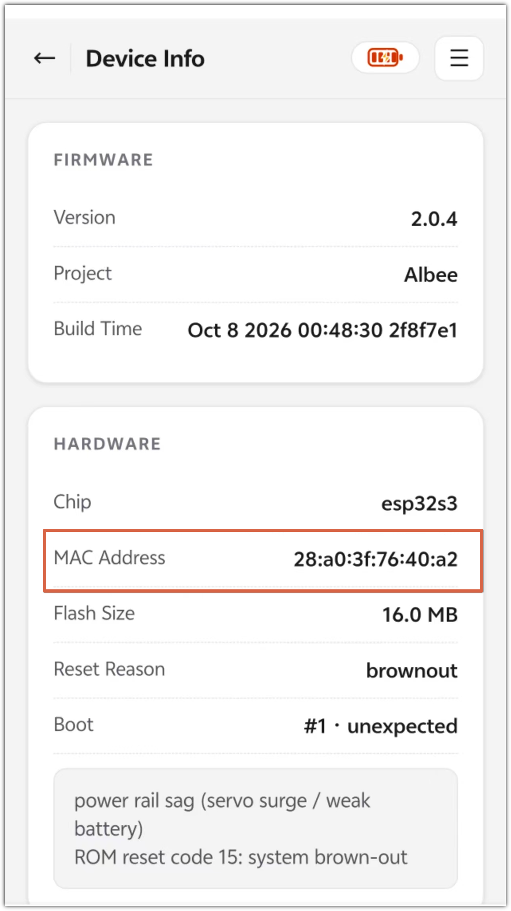
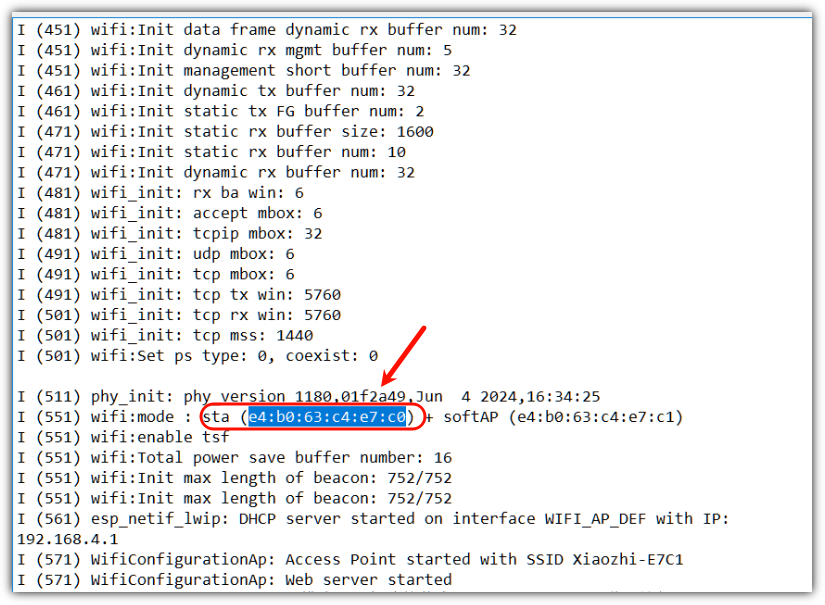

# How to View the MAC Address

## Method 1: Via the Web Page

1. Make sure the device is activated and connected to the network.

2. Get its IP address by talking to it, then connect your phone or computer to the same Wi-Fi (make sure you are on the same local network).

3. Visit `http://<device-ip>/info` in a browser.

   

## Method 2: Via a Serial Terminal Tool

You can use a serial terminal tool — there are many available, such as Tera Term, CoolTerm, etc.

1. Connect Albee to your computer with a Type-C cable (make sure it is powered on). Select the corresponding COM port, click **Open Serial Port**, set the baud rate to 115200, and keep the other settings at their defaults.

2. In the serial log, find the line `wifi:mode : sta ( ... )` — the value shown there (highlighted in blue in the screenshot below) is the MAC address.

---

**Last modified:** 2026-10-08
