# Device Activation Guide
> Firmware: Albee v2.0.4 or later ｜ Audience: End user

## Part 1: Buttons and Controls

Albee has **two physical buttons** and **one touch area**:

| Name | Description | Operation |
| --- | --- | --- |
| Power button (Power Button) | Power key on the body | Long-press 3 s to power on / off |
| Function button (Function Button) | The BOOT button | See the table below |
| Touch control | Touch area on the body | Single tap / double tap (a single tap also stops the alarm) |

**Function button (Function Button) operations:**

| Operation | Effect |
| --- | --- |
| Single-click | ① stop a ringing alarm; ② start or end a conversation round; ③ if Wi-Fi never connects after power-on, single-click to re-enter provisioning mode (no power cycle needed) |
| Double-click | Toggle **real-time barge-in** (once on, just speak to interrupt the reply) |
| Long-press 10 s | Factory reset: erases Wi-Fi credentials, alarms, light groups and all other user settings, then reboots automatically; Wi-Fi provisioning is required again after the reboot |

> [!WARNING]
> A 10-second long-press wipes every user setting and reboots the robot immediately — **avoid pressing it by accident** (for example when the robot is packed in a bag or the button is held down).

## Part 2: Power On and Configure Wi-Fi

1. **Power on**: Long-press the power button for 3 seconds until the LED and the screen light up.

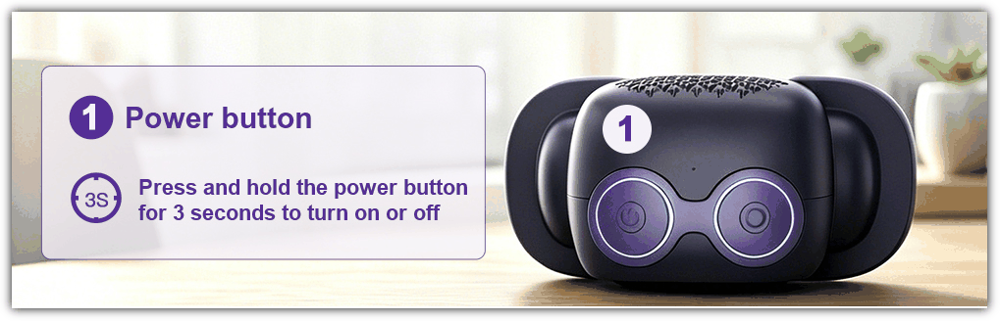

2. **Connect to the device hotspot**: After startup, Albee's screen shows a Wi-Fi hotspot named **Albee-xxxx**. Find and connect to this hotspot in your phone's Wi-Fi settings.

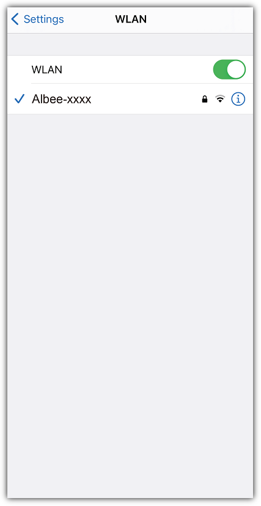

3. **Open the configuration page**: Once connected, the configuration page usually opens automatically on your phone. If it does not pop up, open the browser on your phone, type `192.168.4.1` in the address bar, and visit it. On the configuration page, select or enter the Wi-Fi name (SSID) you want to connect to, and enter the corresponding password.

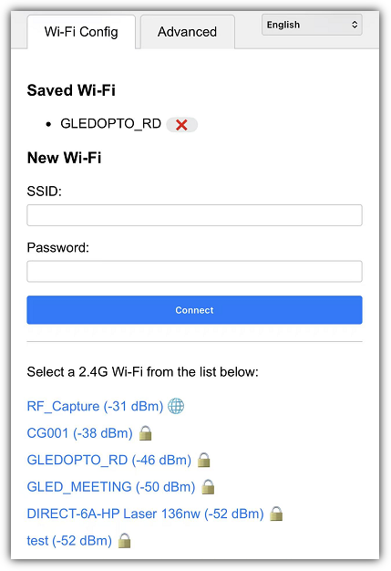

4. Click **Connect**.
5. Wait for the device to restart.

## Part 3: Activate the Device

After the Wi-Fi is configured, an unactivated device will announce a six-digit activation code after restarting; the code is also shown on the screen.

1. Visit <https://xiaozhi.me/>

2. The interface is Chinese by default; you can switch to other languages, as shown below:

   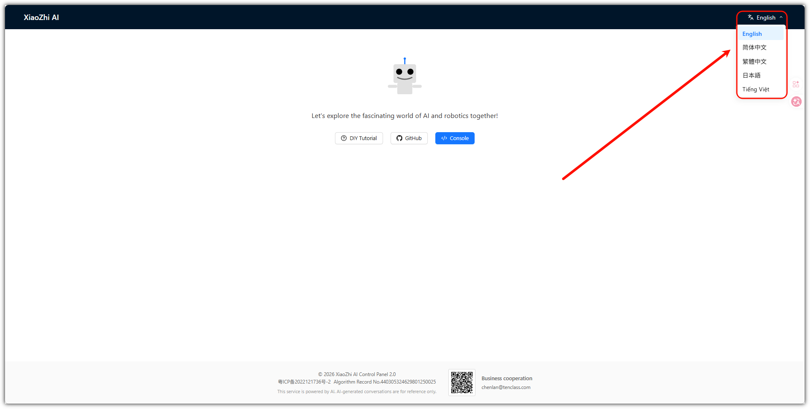

3. Click **Console**.

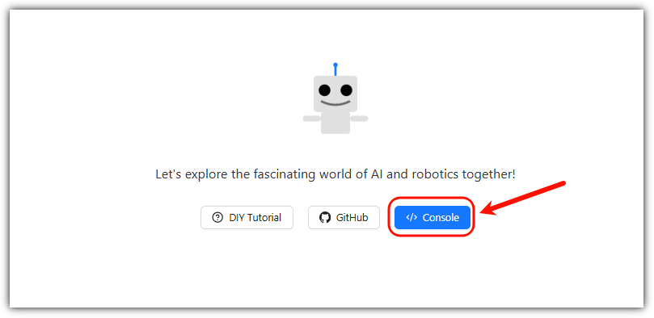

4. Register or log in to your account: choose the country/region code matching your phone number, then enter your phone number.

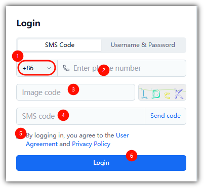

5. Add the device and enter the activation code.

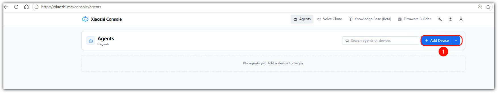

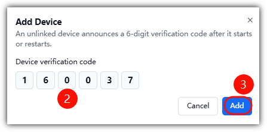

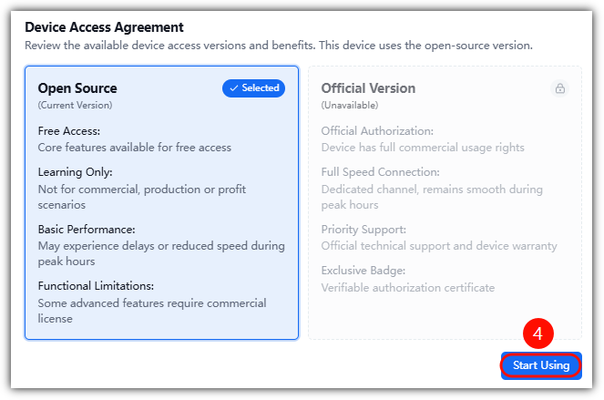

You also need to set the language — for how, see the [XiaoZhi Console Configuration Guide](./xiaozhi-console.md). The common configuration steps are summarized below.

## Part 4: Console Configuration

First, go to the console: <https://xiaozhi.me/>, then click **Configure**

> [!IMPORTANT]
> After completing **all** configuration in the console, you need to **restart the device** (long-press the Power button for 3 seconds to power off, then long-press again for 3 seconds to power on) for the changes to take effect.

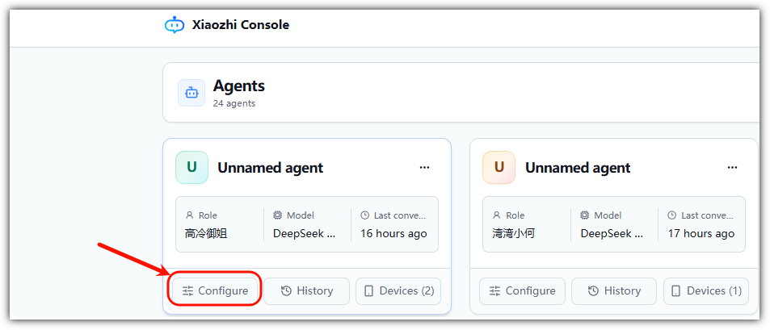

### 1. Set the Language

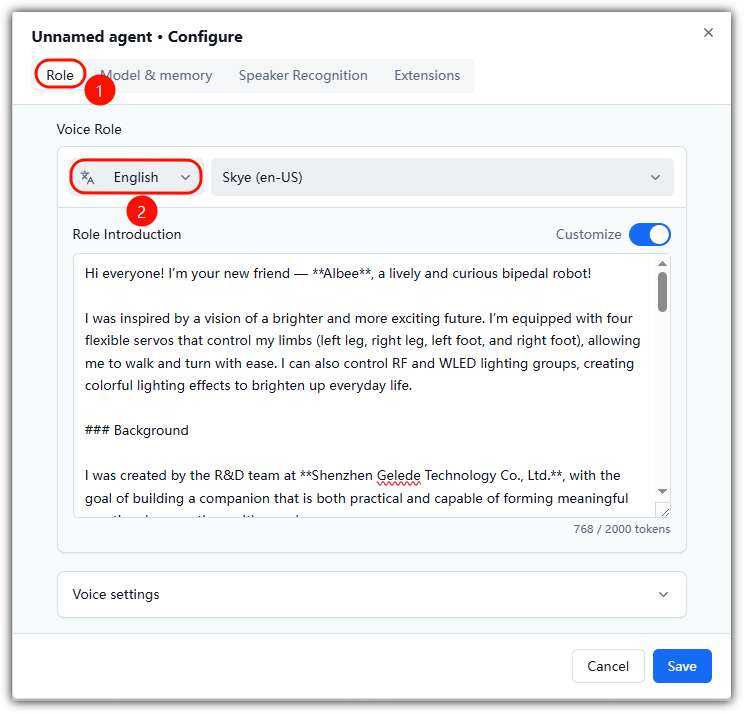

### 2. Set the Voice

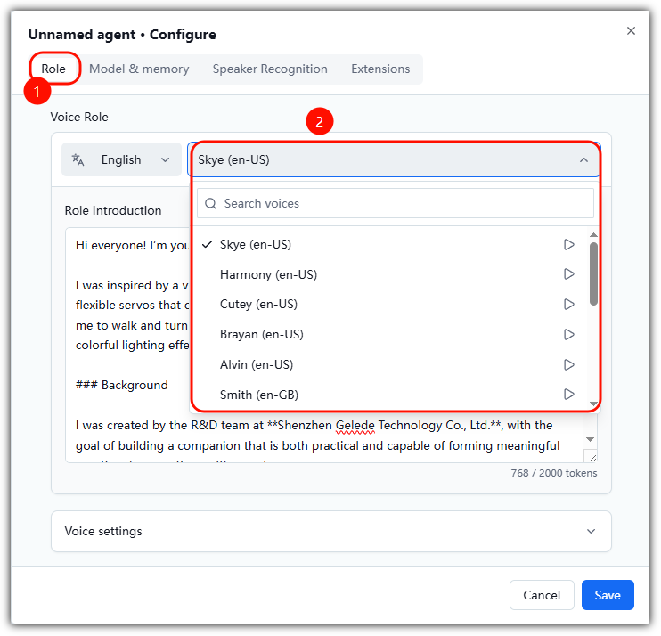

### 3. Set the Role Introduction

**Role Introduction:** used to set the AI robot's role identity, personality, and communication style, so that the robot interacts with you according to the configured role.

For example, you can set roles such as **kids' companion, English teacher, smart butler, story partner, or fun chat buddy** to meet the needs of different scenarios.

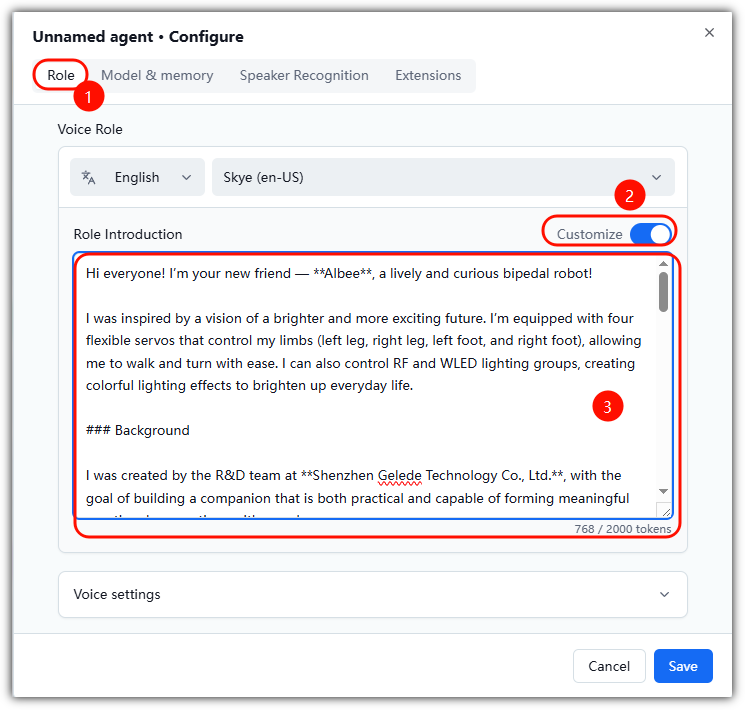

**Reference template**

The ready-made Albee role introduction template (Chinese and English) lives in the [XiaoZhi Console Configuration Guide · Set the Role Introduction](./xiaozhi-console.md#3-set-the-role-introduction).

### 4. Switch the Model

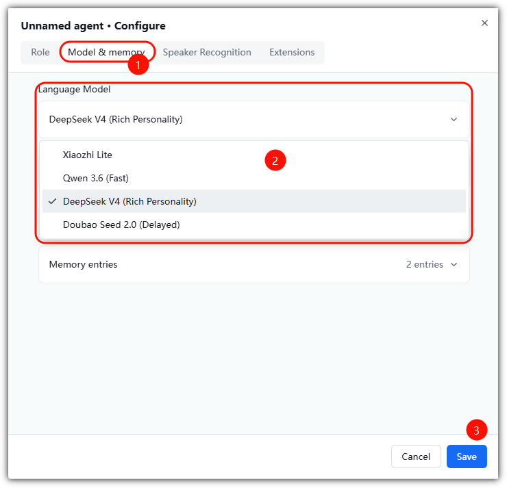

Xiaozhi Lite is selected by default; the other models are unavailable until you complete developer authentication. For details, see [Developer Auth](./developer-auth.md)

### 5. Switch the Memory Mode

When enabled, the robot no longer has to "get to know you from scratch" in every conversation; when disabled, every conversation starts "from zero".

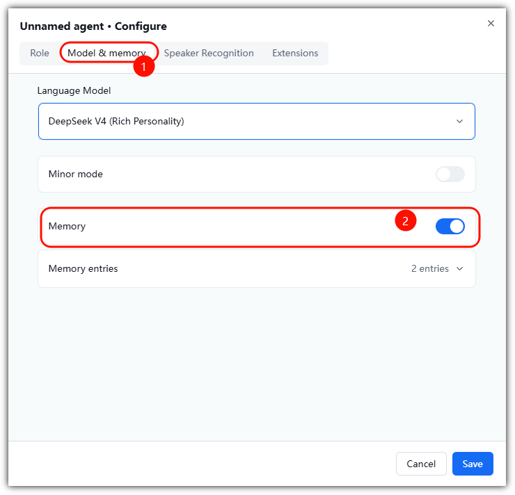

### 6. Voiceprint Recognition

**Voiceprint recognition:** identifies "who is speaking" by the voice characteristics of different users. After enrolling a voiceprint, the robot can recognize specific users, enabling **personalized addressing, exclusive interactions, and family-member differentiation**, making communication smarter and more personal.

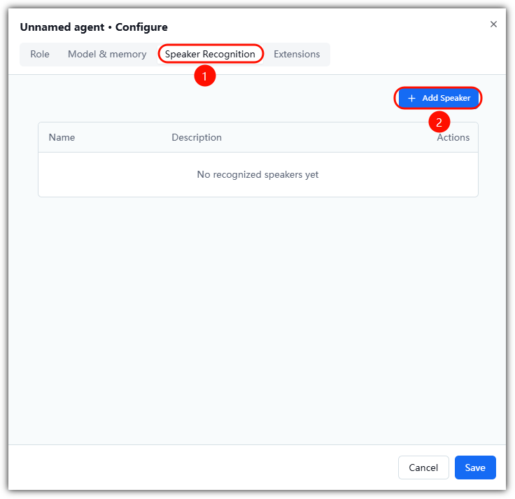

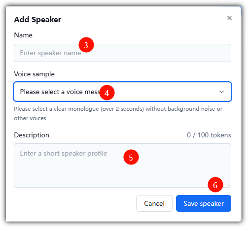

## Part 5: Start Your First Conversation

After the configuration, restart the robot and just talk to it:

1. **Wake it up**: say **"Hi Albee"**, or single-click the function button;
2. **Just speak**: e.g. "Hello", "What time is it?", "Tell me a joke";
3. **Handy commands**:
   - "Set the volume to 30" — too loud or too quiet? Just say it, no settings page needed
   - "Remind me to drink water in ten minutes" — set an alarm by voice
   - "Turn on the living room light" — control a paired light group

No need to wait for the robot to finish before you speak — talking over it **interrupts in real time** (double-click the function button to toggle this mode).

For more, see the [Albee Encyclopaedia](./../albee-encyclopaedia.md).

---

**Last modified:** 2026-10-13
