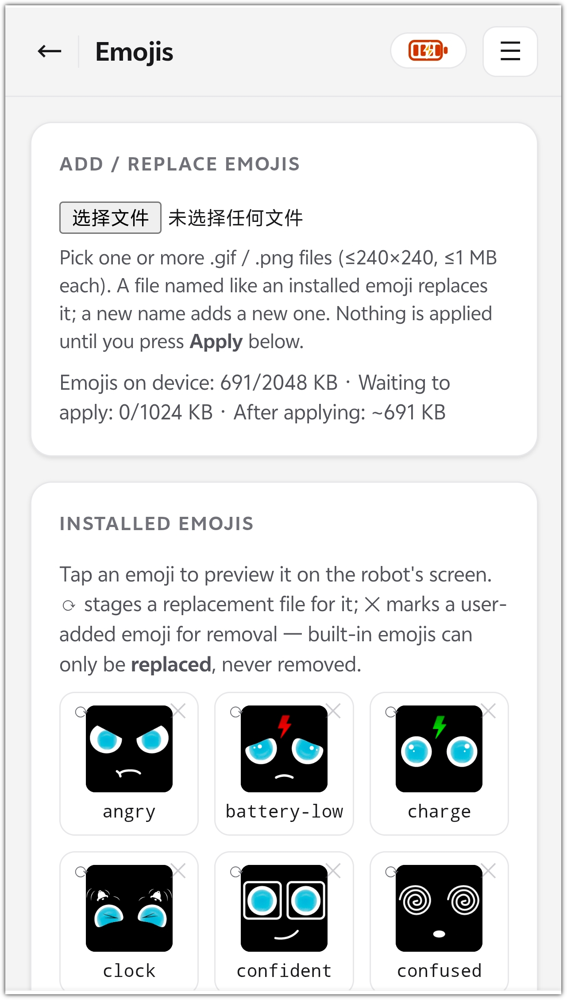

# Emoji Change Guide
> Firmware: Albee v2.0.5 ｜ Audience: End user

## 1. Via the Device Web Page (recommended, v2.0.5+)

No firmware rebuild needed — upload, replace, and delete emoji right in the browser:

1. Open `http://<device-ip>/emoji` in a browser (to get the IP see [Find the Device IP Address](check-device-ip.md)).
2. The page shows thumbnails of all installed emoji (built-in and custom): click any emoji to preview it on the robot's screen; click ⟳ at the top-right corner of a thumbnail to pick a different file for that emoji (no renaming needed); click ✕ to delete a custom emoji — **built-in emoji can be replaced but not deleted**.

3. Upload new emoji: pick one or more `.gif` / `.png` files. The file name (without extension) becomes the emoji name. Rules: must start with a lowercase letter; only `a-z`, `0-9`, `-`, `_`; at most 27 characters. A name that matches an installed emoji replaces it; a new name adds a new emoji. Max 1 MB per file, image size ≤ 240×240.
4. Uploads and deletions first go into a "Pending" list and do not take effect immediately; click **Apply & reboot** to apply all changes at once (the device rebuilds the asset package and reboots), or **Discard** to drop them all. The pending list survives power loss/reboots; losing power during the apply step cannot brick the device — it resumes or rolls back after reboot.
5. Limits: the emoji asset package ≤ 2 MB in total, the pending staging area ≤ 1 MB; the page shows current usage and the estimated size after applying — delete some emoji first if over the limit.
6. If a web PIN lock is set on the device, unlock it first to upload/delete/apply/preview; browsing the list and thumbnails needs no unlock.

> **Tips:**
> - The v2.0.5 asset package adds a boot emoji `power-on` (played for about 3 seconds before connecting, then back to neutral). It is also a built-in emoji and can be replaced on this page.
> - Delivering an asset package via the XiaoZhi console (section 2), or recompiling and flashing the firmware (section 3), **overwrites the asset partition as a whole** — emoji uploaded via the web page will be lost.
> - Custom emoji uploaded via the web page can also be triggered by voice: say "play emoji xxx" to the robot, or see the `self.screen.show_emoji` tool in the [MCP Usage Guide](mcp-usage.md).

## 2. Via the XiaoZhi Console

Visit the XiaoZhi console: https://xiaozhi.me/

## 3. Modify by Recompiling the Firmware

Replace the .gif emoji files under ./extracted_emojis, then rebuild the firmware.

For compiling, flashing, and verification, see: [Firmware Compilation Tutorial](compilation-tutorial.md)

> Note: local OTA upgrade packages (`.ota`) contain only the application firmware, not the asset partition — after upgrading to v2.0.5 via OTA you will not get the new boot emoji `power-on` (the device treats it as "not installed", silently skips it, no error). To get the new asset package, upload via the web page or flash a firmware build that includes the assets.

## Appendix: Emoji Management HTTP API (advanced)

The endpoints behind the `/emoji` page (`main/boards/gledopto-robot/web/web_emoji_api.cc`), for scripts or third-party integrations. GET requests need no unlock; write operations require unlocking first if a PIN is set.

| Endpoint | Method | Request | Response / behavior |
|---|---|---|---|
| `/api/emoji/list` | GET | — | `{"success":true,"emojis":[{"name","file","size","builtin"}]}` (size in bytes; builtin = built-in or not) |
| `/api/emoji/file?name=<filename>` | GET | filename with `.gif`/`.png` extension | image byte stream; carries an ETag, returns 304 on `If-None-Match` hit |
| `/api/emoji/status` | GET | — | `{"state":"idle/working/done/error"[,"error"]}` (rebuild task state) |
| `/api/emoji/staged` | GET | — | `{"staged":[{"name","op":"add/remove","size"}],"space":{"package_used","package_max","stage_used","stage_max","est_after_apply"},"rev":<count>}` (space values in KB) |
| `/api/emoji/staged?name=xx&op=add` | POST | body is the raw GIF/PNG bytes | stage an add/replace (validated: ≤1 MB, ≤240×240, name rules) |
| `/api/emoji/staged?name=xx&op=remove` | POST | — | stage a deletion; built-in emoji and unknown names are rejected |
| `/api/emoji/staged` + `{"clear":true}` | POST | — | clear the entire pending list |
| `/api/emoji/commit` | POST | — | apply all staged changes: rebuilds the asset package in the background, auto-reboots after ~3 s |
| `/api/emoji/play` | POST | `{"name":"happy"}` | preview the given emoji on screen immediately |

Errors are uniformly `{"success":false,"error":"<reason>"}`.

---

**Last modified:** 2026-10-16
