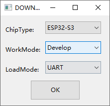

# Firmware Flashing Guide

> Firmware: Albee v2.0.4 or later ｜ Audience: Developer

Two options: flash with the Flash Download Tool on a computer (no IDF environment required), or flash through a web browser. For routine upgrades, [local OTA](./local-ota.md) is easier — upload an `.ota` file in the web page, no computer needed.

## 1. Flashing with the Flash Download Tool

### 1.1 Preparation

1. Install the Flash Download Tool: <https://dl.espressif.com/public/flash_download_tool.zip>
2. Have the firmware file ready
3. Connect the robot to your computer with a Type-C cable and make sure it is powered on (long-press the power button for 3 seconds)

> [!IMPORTANT]
> Use the original cable shipped with the device, or make sure your cable supports data transfer

### 1.2 Download settings

1. Chip type: **ESP32-S3**
2. Work mode: **Develop**
3. Load mode: **UART** (recommended)

### 1.3 Flashing steps

1. Click the file picker on the first row and import the `.bin` firmware file
2. Tick the checkbox in front of that row (required) and enter the flash address `0x0` in the field next to it
3. Select the matching COM port
4. Click **START**; when the progress bar completes the status shows **FINISH**
5. Restart the device afterwards (long-press the power button for 3 seconds to power off, then long-press again for 3 seconds to power on)

## 2. Flashing through a web browser

1. Power the device on
2. Connect the robot to your computer with a Type-C cable
3. Open the flashing page in a browser and download the firmware

## 3. Errors and troubleshooting

**Problem 1: No COM port shows up**

1. Check that the device is powered on
2. Check that the cable supports data transfer
3. Restart the device and try unplugging and replugging a few times

**Problem 2: The program does not run after flashing**

1. Check that the device is powered on
2. Make sure the flash address was set to `0x0`

---

**Official site:** <http://www.gledoptorobots.com>

**For anything not covered above, contact support:** service@gledopto.com

---

**Last modified:** 2026-10-10
