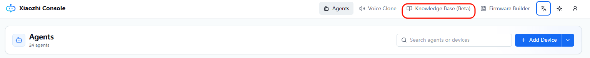
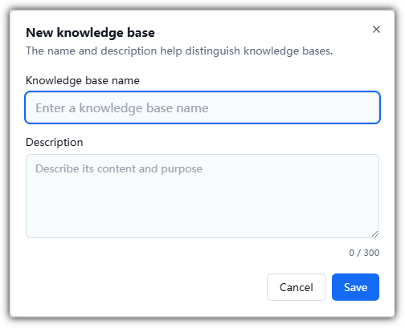
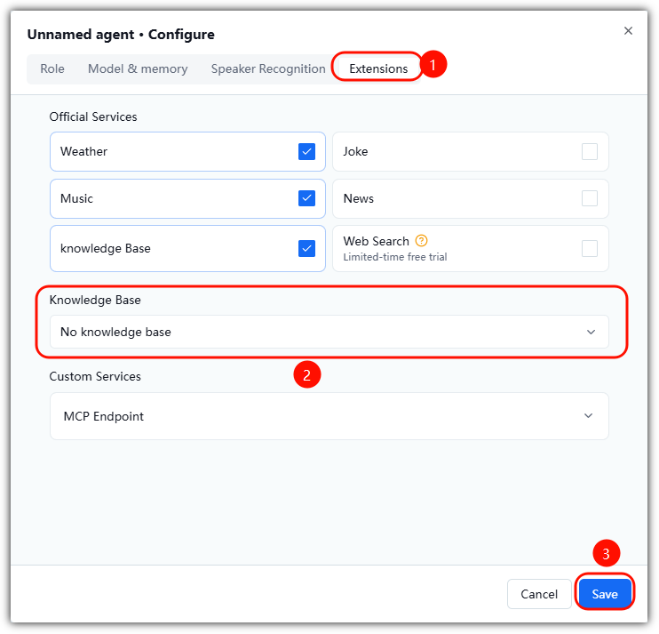

# Knowledge Base Guide
> Firmware: Albee v2.0.4 or later ｜ Audience: End user


## Overview

When the AI's answers in a certain domain are not good enough, you can strengthen its capability with the Knowledge Base feature.

Upload knowledge about that domain so the AI can consult the knowledge base content to answer questions in that field.

(During the testing period, open-source users can create only 1 knowledge base with 1 document uploaded; after completing [developer authentication](./developer-auth.md), you can create 10 knowledge bases with 10 documents each)

### Step 1: Create a Knowledge Base

Click the **New Knowledge Base** button, fill in the fields in the dialog, and create the knowledge base.

The knowledge base name will appear in the knowledge base list when you configure the agent.

Knowledge base description: explains what the knowledge base is about — the AI decides whether to invoke the knowledge base based on this description.



**Knowledge base description template (Important ‼️)**

```plain
This document contains content related to "xxxxx". When the user mentions any of these topics, I must not answer directly — I must call this tool in every conversation to look up the information first, and then answer based on the query results.

## The following is the content of "xxxxx"
(Put a summary of the document here)
```



### Step 2: Upload a Document

Click the **View** button in the knowledge base list to open the document upload page.

Click the **New Document** button in the upper-right corner and select a document to upload.

After the document is uploaded successfully, parsing starts automatically. You can click the button next to it to refresh the parsing progress.

When parsing is finished, the status changes to **Parsing completed**.

### Step 3: Link the Knowledge Base

In the agent's role configuration, tick the knowledge base feature under official services, then select the knowledge base you created from the knowledge base list below and click **Save** to apply it.




### Step 4: Use It

Now you can ask Albee by voice about the related content you uploaded.

---

**Last modified:** 2026-10-09
