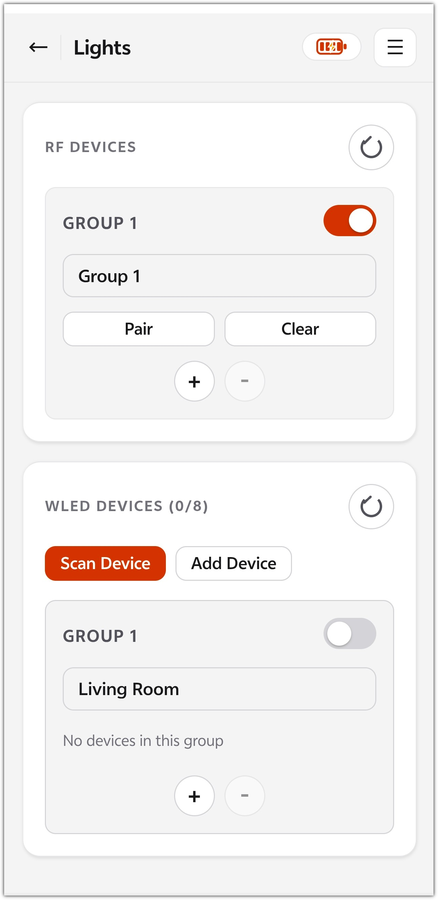

# Lighting Control Guide

This document describes how to control the lights connected to the robot in three ways: via the **web page**, **voice (AI)**, and the **HTTP API**. The related code lives in `main/boards/gledopto-robot/light/` (lighting control core) and `main/boards/gledopto-robot/web/` (built-in web server).

> **Compatibility note**: The lighting control feature is **fully compatible with all GLEDOPTO 2.4G RF LED strip controllers** as well as **WLED-series controllers** — no adaptation needed. Once paired/added, they are fully controllable.

## 1. Overview

The robot acts as a lighting gateway and supports two kinds of lights, both managed uniformly as "groups":

| Light Type | Compatibility | Communication | Groups | Per-group Capabilities | Saved Across Power Loss |
| ---------- | ------------------------------------ | ---------------------------- | ------- | ----------------------------- | ---------------------- |
| **RF lights** | **All GLEDOPTO 2.4G RF LED strip controllers** | Direct RF via the robot's built-in 2.4G module | 1–4 groups | on/off, brightness, color, color temperature | group name, on/off state |
| **WLED strips** | **WLED-series controllers** (running WLED firmware) | HTTP control over the LAN | 1–4 groups | on/off, brightness, color, color temperature, effects | device list, group names |

Routing rules (shared by web, voice, and API):

- Addressing is by group name or `"all"`: `all` applies to every group of both light types; RF and WLED groups with the **same name** are controlled together;
- Group names support fuzzy matching (similarity ≥ 80%), so imprecisely spoken names still hit the right group;
- Group name limits: non-empty, ≤ 19 bytes (about 6 Chinese characters), and must not duplicate another group's name.

## 2. Opening the Control Page

About 2 seconds after the robot joins Wi-Fi, the built-in web server starts automatically (port 80). Open this address in a browser:

```
http://<robot-ip>/light
```

Ways to get the robot's IP:

- **Serial log**: filter for `WebServer` in the monitor (`idf.py monitor`) — at startup it prints `Access URL: http://x.x.x.x/light`;
- **Router admin page**: check the newly connected devices;
- **Ask by voice**: ask the robot "what's your IP" to get the IP directly; saying "configure the lights" makes it speak the full control page address (`IP/light`).

The page has two sections: **RF Devices** on top (orange border) and **WLED Devices** below (green border).

## 3. RF Light Control

> Compatible with **all GLEDOPTO 2.4G RF LED strip controllers**: power any model, pair it as described in 3.1, and it comes under control.



### 3.1 First-time Pairing (Pair)

RF lights bind to one of the robot's groups via a pairing code:

1. Find the target group on the web page and click **Pair**;
2. After confirming the dialog, **power-cycle the RF light/controller within 5 seconds** (the repowered light enters pairing mode and remembers that group's pairing code);
3. The page shows `Group N paired!` on success.

Key points:

- Pair one group at a time; to put several lights into the same group, power-cycle them together within the 5-second window;
- Pairing failures are usually caused by the power-cycle taking more than 5 seconds — just retry;
- To move a light to another group: Pair in the new group and restart the light first; the old group's pairing code can be Cleared afterwards.

### 3.2 Daily On/Off

- **Group switch**: the toggle switch on the right of each group card;
- **Master switch**: the round power button on the right of the section title; it sends on/off to all displayed groups in turn.

Switch states are persisted to NVS, so the web page still shows the correct state after the robot reboots.

### 3.3 Group Names

Click a group name input box to open the edit dialog:

- 1–19 bytes (about 6 Chinese characters); must not duplicate another group's name (validated on both the front end and the back end);
- Renames are saved in the robot's NVS and survive reboots;
- Group names are the addressing basis for voice control — use names that are easy to say out loud, such as "living room light".

### 3.4 Number of Displayed Groups (+/-)

The **+ / -** buttons at the bottom of the last group card increase or decrease the number of groups shown on the page (1–4). This is only a **browser-local display setting** (stored in localStorage) and does not affect the groups already paired inside the robot.

### 3.5 Clearing Pairing (Clear / Clear All)

- **Clear**: clears a single group's pairing code; that group's lights will no longer respond to the robot;
- **Clear All** (group 0): clears the pairing codes of all groups.

After clearing, you must Pair again to restore control.

## 4. WLED Strip Control

> Compatible with **WLED-series controllers**: any device running WLED firmware on the same network segment as the robot can be discovered and fully controlled.

### 4.1 Adding Devices

WLED devices must be on the **same LAN** as the robot. Two ways to add them:

- **Scan Device (recommended)**: the robot scans the LAN via mDNS (`_wled._tcp`) and lists the devices found; tick them, choose a group for each, and click **Add Selected**. Devices that were already added do not appear again.
- **Add Device (manual)**: directly enter the WLED's IP address and pick a group. If the IP already exists, its group assignment is updated automatically.

The device limit is **8**; the title bar shows the current count `(n/8)`.

### 4.2 Managing Devices

- Each device shows its IP; click **Edit** to change its group or delete the device;
- Deleting a group (the **-** button in the WLED section): if the group contains devices, a confirmation dialog pops up; once confirmed, the devices in that group are deleted too;
- Group names are clickable to rename (defaults: Living Room / Bedroom / Kitchen / Study); renames are saved in the robot's NVS, and the devices in the group automatically migrate to the renamed group.

### 4.3 On/Off and Advanced Control

- The web page provides group switches and a master switch (same as RF);
- **Color, brightness, color temperature, and effects** are controlled by voice (see the next section).

## 5. Voice (AI) Control

Voice commands are converted by the AI backend into MCP tool calls (see [mcp-usage.md](./mcp-usage.md) for the protocol). The main tools:

| MCP Tool | Function | Key Parameters |
| ------------------------------------------------------------ | ------------------------------------------ | ------------------------------------------------------- |
| `self.light.control_group` | on/off/toggle | `group_name` (group name or `all`), `action` (on/off/toggle) |
| `self.light.set_group_color` | set RGB color | `group_name`, `r`/`g`/`b` (0-255) |
| `self.light.set_group_brightness` | set brightness | `group_name`, `brightness` (0-255) |
| `self.light.set_group_color_temp` | set color temperature | `group_name`, `temperature` |
| `self.light.set_group_effect` | WLED effect | `group_name`, `fx` (effect number) |
| `self.light.get_all_group_name` | list all group names | none |
| `self.light.get_ip` / `get_light_control_ip` | get device IP / lighting control page URL (`IP/light`) | none |
| `self.light.rf_pair_group` / `rf_clear_group` / `rf_clear_all` | RF pairing/clearing | `group_id` |

Example phrases:

- "Turn on the living room light" → `control_group("living room light", "on")`
- "Turn off all the lights" → `control_group("all", "off")`
- "Set the bedroom strip to blue" → `set_group_color("bedroom", 0, 0, 255)`
- "Change the strip effect" → `set_group_effect` / random effect

> For white/warm light, prefer the color-temperature tool over RGB (RGB white looks reddish).

## 6. HTTP API Reference

All endpoints are served on the robot's port 80 and return JSON (with a boolean `success` field). They can be used for home-automation integration.

### RF Lights

| Endpoint | Method | Request Body | Description |
| -------------------- | ---- | -------------------- | -------------------------------------------------- |
| `/api/light/status` | GET | — | returns all RF groups `[{id, name, state}]` |
| `/api/light/control` | POST | `{group_id, action}` | `group_id` 1-4; **0 means all groups**; `action`: on/off |
| `/api/light/rename` | POST | `{group_id, name}` | group name ≤ 19 bytes and unique |
| `/api/light/pair` | POST | `{group_id}` | opens the 5-second pairing window |
| `/api/light/clear` | POST | `{group_id}` | clears pairing; 0 means all |

### WLED

| Endpoint | Method | Request Body | Description |
| ------------------------- | ---- | ------------------- | --------------------- |
| `/api/wled/devices` | GET | — | device list + the 4 group names |
| `/api/wled/scan` | GET | — | mDNS scan for WLED devices on the LAN |
| `/api/wled/add` | POST | `{name, ip, group}` | add a device (limit 8) |
| `/api/wled/edit` | POST | `{ip, name, group}` | change a device's group |
| `/api/wled/delete` | POST | `{ip}` | delete a device |
| `/api/wled/control` | POST | `{ip, action}` | switch a single device |
| `/api/wled/group/control` | POST | `{group, action}` | switch by group name |
| `/api/wled/rename` | POST | `{group_id, name}` | rename a group (1-4) |

Examples:

```bash
# Check the state of all light groups
curl http://192.168.1.50/api/light/status

# Turn on RF group 2 (group numbers start at 1)
curl -X POST http://192.168.1.50/api/light/control \
     -H "Content-Type: application/json" \
     -d '{"group_id": 2, "action": "on"}'

# Turn off the WLED group named Bedroom
curl -X POST http://192.168.1.50/api/wled/group/control \
     -H "Content-Type: application/json" \
     -d '{"group": "Bedroom", "action": "off"}'
```

## 7. FAQ

- **Control page won't open**: confirm the robot has joined Wi-Fi and that your phone/computer is on the same network segment; check the IP printed as `Access URL` in the serial log; the router's DHCP may change the IP, so it is recommended to bind a static IP for the robot on the router.
- **RF pairing keeps failing**: the power-cycle must be completed **within 5 seconds** after clicking Pair; lights with a dying battery or insufficient power supply may also fail to receive the pairing code.
- **WLED not found by scanning**: confirm the WLED device is on the same LAN as the robot (watch out for routers with AP isolation enabled); you can also use Add Device to enter the IP manually.
- **Voice commands with a group name get no response**: group names are exactly as shown on the web page; use `get_all_group_name` or the web page to check the actual names; overly casual phrasing may fall below the 80% similarity threshold.
- **RF and WLED groups with the same name get controlled together "by mistake"**: this is by design (same-name groups are linked); rename them if you need independent control.

---

**Last modified:** 2026-09-10
