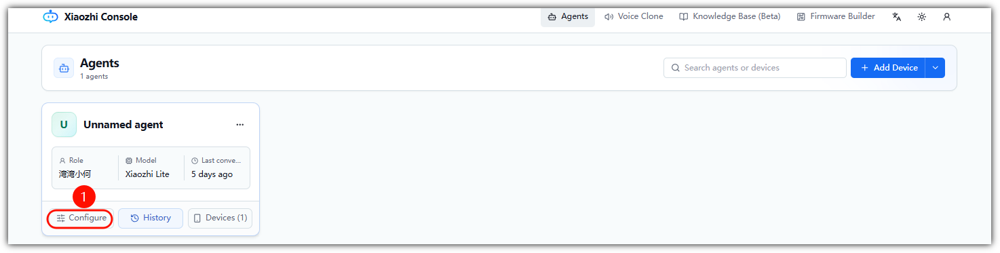
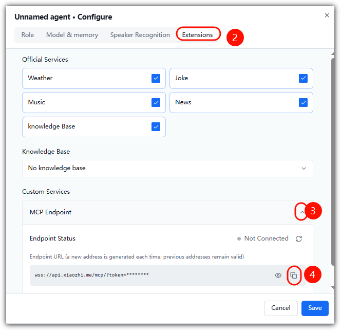

# How to Get the MCP Access-Point Address

> Firmware: Albee v2.0.4 or later ｜ Audience: End user

1. Log in to the XiaoZhi console: https://xiaozhi.me/
2. Select your device
3. Click through Console -> Configure -> Extensions -> Copy MCP access point

---

**Last modified:** 2026-10-13
