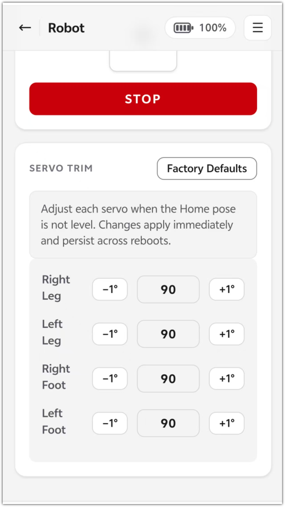
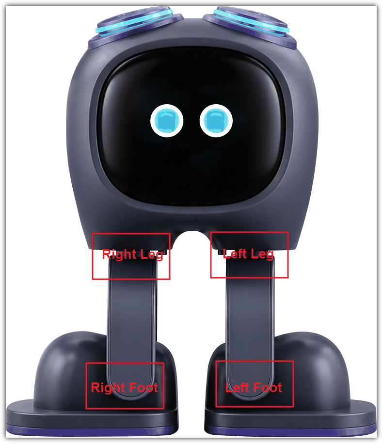
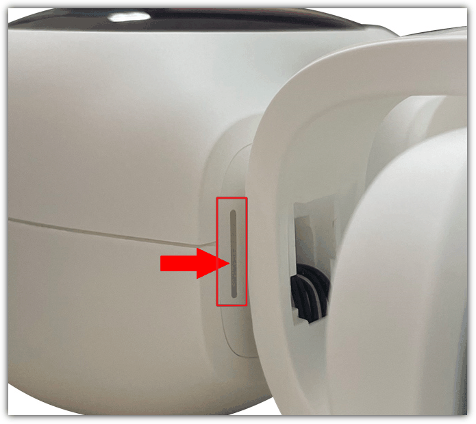

# Servo Calibration Guide
> Firmware: Albee v2.0.5 ｜ Audience: End user

> Why calibrate? In the reset pose the robot stands upright with all four servos at 90°. For various reasons the reset pose may have a slight deviation, which can make the robot walk incorrectly.

## Calibration Steps

1. Make sure the device is activated and connected to the network.
2. Find the device IP address (see [Find the Device IP Address](./check-device-ip.md)), then connect your phone or computer to the same Wi-Fi (same local network).
3. Visit `http://<device-ip>/robot` in a browser.
4. With the robot at rest, adjust the corresponding servo — click -1° / +1° to fine-tune the four servos (**note: lay the robot down face-up while adjusting**).

5. The positions correspond as follows:

6. There is a scale mark on the leg for reference — make sure the side of the leg is flush with the scale mark.

---

**Last modified:** 2026-10-09
