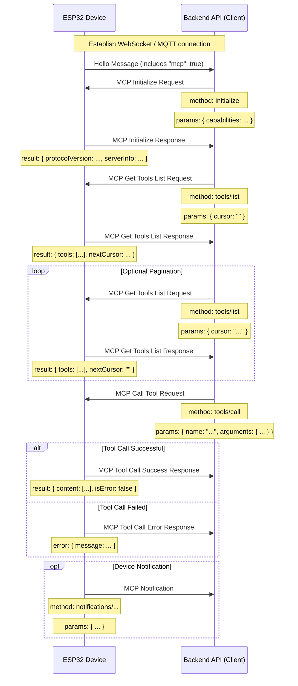

# MCP (Model Context Protocol) Interaction Flow

NOTICE: AI-assisted document. When implementing backend services, verify details against the code!!

In this project, MCP is used for communication between the backend API (MCP client) and the ESP32 device (MCP server), allowing the backend to discover and invoke the functions (tools) provided by the device.

## Protocol Format

According to the code (`main/protocols/protocol.cc`, `main/mcp_server.cc`), MCP messages are carried inside the payload of a base transport protocol message (WebSocket or MQTT). The payload itself follows the [JSON-RPC 2.0](https://www.jsonrpc.org/specification) specification.

Overall message structure:

```json
{
  "session_id": "...", // Session ID
  "type": "mcp",       // Message type, fixed to "mcp"
  "payload": {         // JSON-RPC 2.0 payload
    "jsonrpc": "2.0",
    "method": "...",   // Method name (e.g. "initialize", "tools/list", "tools/call")
    "params": { ... }, // Method parameters (for a request)
    "id": ...,         // Request ID (for requests and responses)
    "result": { ... }, // Method execution result (for a success response)
    "error": { ... }   // Error information (for an error response)
  }
}
```

The `payload` part is a standard JSON-RPC 2.0 message:

- `jsonrpc`: always the string `"2.0"`.
- `method`: name of the method to invoke (for a request).
- `params`: parameters of the method, a structured value, usually an object (for a request).
- `id`: request identifier, provided by the client and echoed back unchanged by the server. Used to match responses to requests.
- `result`: the result of a successful method execution (for a success response).
- `error`: error information when method execution fails (for an error response).

## Interaction Flow and Timing

MCP interaction revolves around the client (backend API) discovering and invoking "tools" on the device.

1.  **Connection Establishment and Capability Announcement**

    - **When:** After the device boots and successfully connects to the backend API.
    - **Sent by:** The device.
    - **Message:** The device sends the base protocol `hello` message to the backend API, including the list of features it supports, e.g. MCP support (`"mcp": true`).
    - **Example (base protocol message, not an MCP payload):**
      ```json
      {
        "type": "hello",
        "version": ...,
        "features": {
          "mcp": true,
          ...
        },
        "transport": "websocket", // or "mqtt"
        "audio_params": { ... },
        "session_id": "..." // Set by the device after receiving the server hello
      }
      ```

2.  **MCP Session Initialization**

    - **When:** After the backend API receives the device `hello` message and confirms MCP support; usually sent as the first request of the MCP session.
    - **Sent by:** Backend API (client).
    - **Method:** `initialize`
    - **Message (MCP payload):**

      ```json
      {
        "jsonrpc": "2.0",
        "method": "initialize",
        "params": {
          "capabilities": {
            // Client capabilities, optional

            // Camera vision
            "vision": {
              "url": "...", // Image processing URL (must be an http URL, not websocket)
              "token": "..." // URL token
            }

            // ... other client capabilities
          }
        },
        "id": 1 // Request ID
      }
      ```

    - **Device response timing:** After the device receives and processes the `initialize` request.
    - **Device response message (MCP payload):**
      ```json
      {
        "jsonrpc": "2.0",
        "id": 1, // Matches the request ID
        "result": {
          "protocolVersion": "2024-11-05",
          "capabilities": {
            "tools": {} // Tool details are not listed here; use tools/list
          },
          "serverInfo": {
            "name": "...", // Device name (BOARD_NAME)
            "version": "..." // Device firmware version
          }
        }
      }
      ```

3.  **Discovering the Device Tool List**

    - **When:** When the backend API needs the list of functions (tools) currently supported by the device and how to invoke them.
    - **Sent by:** Backend API (client).
    - **Method:** `tools/list`
    - **Message (MCP payload):**
      ```json
      {
        "jsonrpc": "2.0",
        "method": "tools/list",
        "params": {
          "cursor": "",        // Pagination cursor, empty string on the first request
          "withUserTools": false // Optional; set true to also list user-only (admin) tools
        },
        "id": 2 // Request ID
      }
      ```
    - **Device response timing:** After the device receives the `tools/list` request and builds the tool list.
    - **Device response message (MCP payload):**
      ```json
      {
        "jsonrpc": "2.0",
        "id": 2, // Matches the request ID
        "result": {
          "tools": [ // List of tool objects
            {
              "name": "self.get_device_status",
              "description": "...",
              "inputSchema": { ... } // Parameter schema
            },
            {
              "name": "self.audio_speaker.set_volume",
              "description": "...",
              "inputSchema": { ... } // Parameter schema
            }
            // ... more tools
          ],
          "nextCursor": "..." // Present only when more pages remain
        }
      }
      ```
    - **Pagination:** Responses are capped at roughly 8 KB. If `nextCursor` is present and non-empty, the client must send another `tools/list` request with that value in `params.cursor` to fetch the next page of tools.

4.  **Invoking a Device Tool**

    - **When:** When the backend API needs to execute a specific function on the device.
    - **Sent by:** Backend API (client).
    - **Method:** `tools/call`
    - **Message (MCP payload):**
      ```json
      {
        "jsonrpc": "2.0",
        "method": "tools/call",
        "params": {
          "name": "self.audio_speaker.set_volume", // Name of the tool to invoke
          "arguments": {
            // Tool arguments, as an object
            "volume": 50 // Argument name and value
          }
        },
        "id": 3 // Request ID
      }
      ```
    - **Device response timing:** The device validates the arguments (each argument is type-checked against the tool schema; a missing argument without a default value triggers an error response), executes the tool on a background task pool, and replies after completion.
    - **Device success response message (MCP payload):**
      ```json
      {
        "jsonrpc": "2.0",
        "id": 3, // Matches the request ID
        "result": {
          "content": [
            // Tool execution result content
            { "type": "text", "text": "true" } // Example: set_volume returns bool
          ],
          "isError": false // Indicates success
        }
      }
      ```
      The return value of the tool callback is serialized into `content`: bool becomes `"true"`/`"false"`, int becomes its decimal string, string is passed through as-is.
    - **Device error response message (MCP payload):**
      ```json
      {
        "jsonrpc": "2.0",
        "id": 3, // Matches the request ID
        "error": {
          "message": "Unknown tool: self.non_existent_tool" // Error description
        }
      }
      ```
      Note: this implementation's error object carries a `message` field only, without a JSON-RPC numeric `code`.

5.  **Device-Initiated Messages (Notifications)**

    - JSON-RPC notifications (messages without an `id` field) would follow this shape:
      ```json
      {
        "jsonrpc": "2.0",
        "method": "notifications/state_changed", // Example method name
        "params": {
          "newState": "idle",
          "oldState": "connecting"
        }
        // No id field
      }
      ```
    - **Status in this firmware:** the device currently only sends responses to backend requests (`ReplyResult` / `ReplyError` via `Application::SendMcpMessage`); no device-initiated MCP notifications are sent. The `SendMcpMessage` path exists if a future feature needs them.
    - **Backend handling:** on receiving a notification, the backend processes it but does not reply.

## Sequence Diagram

Below is a simplified sequence diagram showing the main MCP message flow:



This document outlines the main MCP interaction flow in this project. For parameter details and tool functionality, refer to `McpServer::AddCommonTools` in `main/mcp_server.cc` and the board-level registration sites (robot motion, lights, reminders, power) listed in [`mcp-usage.md`](./mcp-usage.md).
