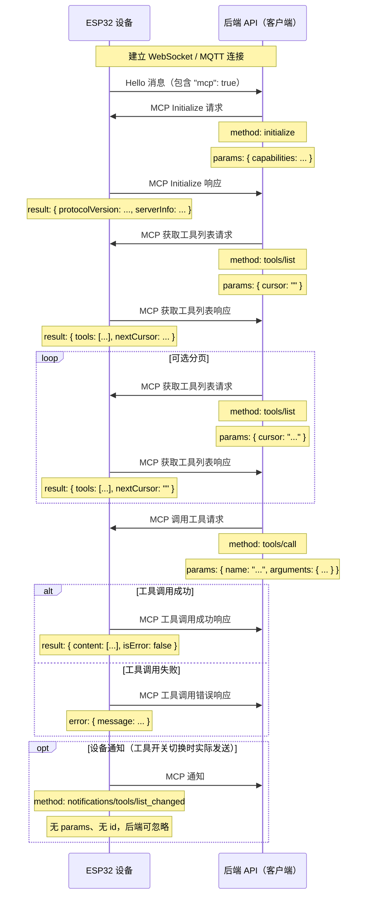

# MCP（Model Context Protocol）交互流程
> 适用固件：Albee v2.0.5 ｜ 适用对象：开发者
> [!WARNING]
> 面向自建服务端的开发者：本篇基于当前固件代码整理，协议细节可能随版本演进，**对接前请以设备端源码为准**。普通用户无需阅读本篇。


注意：AI 辅助编写的文档。实现后端服务时，请对照代码核实细节！！

在本项目中，MCP 用于后端 API（MCP 客户端）与 ESP32 设备（MCP 服务器）之间的通信，使后端能够发现并调用设备提供的功能（工具）。

## 协议格式

根据代码（`main/protocols/protocol.cc`、`main/mcp_server.cc`），MCP 消息承载在基础传输协议消息（WebSocket 或 MQTT）的 payload 中。payload 本身遵循 [JSON-RPC 2.0](https://www.jsonrpc.org/specification) 规范。

整体消息结构：

```json
{
  "session_id": "...", // 会话 ID
  "type": "mcp",       // 消息类型，固定为 "mcp"
  "payload": {         // JSON-RPC 2.0 负载
    "jsonrpc": "2.0",
    "method": "...",   // 方法名（如 "initialize"、"tools/list"、"tools/call"）
    "params": { ... }, // 方法参数（请求时）
    "id": ...,         // 请求 ID（请求和响应都有）
    "result": { ... }, // 方法执行结果（成功响应时）
    "error": { ... }   // 错误信息（错误响应时）
  }
}
```

`payload` 部分是标准的 JSON-RPC 2.0 消息：

- `jsonrpc`：恒为字符串 `"2.0"`。
- `method`：要调用的方法名（请求时）。
- `params`：方法参数，结构化值，通常是对象（请求时）。
- `id`：请求标识符，由客户端提供，服务器原样回传。用于将响应与请求配对。
- `result`：方法执行成功时的结果（成功响应时）。
- `error`：方法执行失败时的错误信息（错误响应时）。

## 交互流程与时序

MCP 交互围绕客户端（后端 API）发现并调用设备上的"工具"展开。

1.  **连接建立与能力宣告**

    - **时机：** 设备启动并成功连接后端 API 之后。
    - **发送方：** 设备。
    - **消息：** 设备向后端 API 发送基础协议的 `hello` 消息，包含其支持的能力列表，例如 MCP 支持（`"mcp": true`）。
    - **示例（基础协议消息，不是 MCP payload）：**
      ```json
      {
        "type": "hello",
        "version": ...,
        "features": {
          "mcp": true,
          ...
        },
        "transport": "websocket", // 或 "mqtt"
        "audio_params": { ... },
        "session_id": "..." // 设备收到服务器 hello 后设置
      }
      ```

2.  **MCP 会话初始化**

    - **时机：** 后端 API 收到设备 `hello` 消息并确认支持 MCP 之后；通常作为 MCP 会话的第一个请求发出。
    - **发送方：** 后端 API（客户端）。
    - **方法：** `initialize`
    - **消息（MCP payload）：**

      ```json
      {
        "jsonrpc": "2.0",
        "method": "initialize",
        "params": {
          "capabilities": {
            // 客户端能力，可选

            // 摄像头视觉
            "vision": {
              "url": "...", // 图像处理 URL（必须是 http URL，不能是 websocket）
              "token": "..." // URL 令牌
            }

            // ... 其他客户端能力
          }
        },
        "id": 1 // 请求 ID
      }
      ```

    - **设备响应时机：** 设备收到并处理 `initialize` 请求之后。
    - **设备响应消息（MCP payload）：**
      ```json
      {
        "jsonrpc": "2.0",
        "id": 1, // 与请求 ID 对应
        "result": {
          "protocolVersion": "2024-11-05",
          "capabilities": {
            "tools": {} // 此处不列出工具详情；请使用 tools/list
          },
          "serverInfo": {
            "name": "...", // 设备名（BOARD_NAME）
            "version": "..." // 设备固件版本
          }
        }
      }
      ```

3.  **发现设备工具列表**

    - **时机：** 后端 API 需要设备当前支持的功能（工具）列表及其调用方式时。
    - **发送方：** 后端 API（客户端）。
    - **方法：** `tools/list`
    - **消息（MCP payload）：**
      ```json
      {
        "jsonrpc": "2.0",
        "method": "tools/list",
        "params": {
          "cursor": "",        // 分页游标，首次请求为空字符串
          "withUserTools": false // 可选；设为 true 可同时列出仅用户可用（管理）工具
        },
        "id": 2 // 请求 ID
      }
      ```
    - **设备响应时机：** 设备收到 `tools/list` 请求并构建完工具列表之后。
    - **设备响应消息（MCP payload）：**
      ```json
      {
        "jsonrpc": "2.0",
        "id": 2, // 与请求 ID 对应
        "result": {
          "tools": [ // 工具对象列表
            {
              "name": "self.get_device_status",
              "description": "...",
              "inputSchema": { ... } // 参数模式
            },
            {
              "name": "self.audio_speaker.set_volume",
              "description": "...",
              "inputSchema": { ... } // 参数模式
            }
            // ... 更多工具
          ],
          "nextCursor": "..." // 仅当还有更多页时出现
        }
      }
      ```
    - **分页：** 响应大小上限约 8 KB。如果存在非空的 `nextCursor`，客户端必须以该值作为 `params.cursor` 再次发送 `tools/list` 请求，获取下一页工具。
    - **过滤：** 通过网页 "MCP Tools" 页禁用的工具不会出现在 `tools/list` 响应中（不上报后端，也不占用后端的工具数量配额）。某页工具全部被禁用时该页被跳过、直接返回下一页内容，属正常现象。设备切换工具开关后会发送 `notifications/tools/list_changed` 通知（见第 5 节）。

4.  **调用设备工具**

    - **时机：** 后端 API 需要在设备上执行某个具体功能时。
    - **发送方：** 后端 API（客户端）。
    - **方法：** `tools/call`
    - **消息（MCP payload）：**
      ```json
      {
        "jsonrpc": "2.0",
        "method": "tools/call",
        "params": {
          "name": "self.audio_speaker.set_volume", // 要调用的工具名
          "arguments": {
            // 工具参数，对象形式
            "volume": 50 // 参数名和值
          }
        },
        "id": 3 // 请求 ID
      }
      ```
    - **设备响应时机：** 设备校验参数（每个参数按工具模式做类型检查；缺少且无默认值的参数会触发错误响应），在后台任务池中执行工具，完成后回复。
    - **设备成功响应消息（MCP payload）：**
      ```json
      {
        "jsonrpc": "2.0",
        "id": 3, // 与请求 ID 对应
        "result": {
          "content": [
            // 工具执行结果内容
            { "type": "text", "text": "true" } // 示例：set_volume 返回 bool
          ],
          "isError": false // 表示成功
        }
      }
      ```
      工具回调的返回值会被序列化进 `content`：bool 变为 `"true"`/`"false"`，int 变为其十进制字符串，string 原样传递。
    - **设备错误响应消息（MCP payload）：**
      ```json
      {
        "jsonrpc": "2.0",
        "id": 3, // 与请求 ID 对应
        "error": {
          "message": "Unknown tool: self.non_existent_tool" // 错误描述
        }
      }
      ```
      注意：本实现的错误对象只带 `message` 字段，没有 JSON-RPC 的数字 `code`。
      调用被网页 "MCP Tools" 页禁用的工具时，错误消息为 `Tool disabled: <工具名>`——由设备端强制执行，即使后端仍缓存着旧的工具列表也无法绕过。

5.  **设备主动消息（通知）**

    - JSON-RPC 通知（不含 `id` 字段的消息）形如：
      ```json
      {
        "jsonrpc": "2.0",
        "method": "notifications/state_changed", // 示例方法名
        "params": {
          "newState": "idle",
          "oldState": "connecting"
        }
        // 没有 id 字段
      }
      ```
    - **本固件现状：** 除对后端请求的响应（`ReplyResult` / `ReplyError`）外，当网页 "MCP Tools" 页切换工具开关时，设备会主动发送 `notifications/tools/list_changed` 通知，提示后端重新执行 `tools/list`：
      ```json
      {
        "jsonrpc": "2.0",
        "method": "notifications/tools/list_changed"
      }
      ```
      该通知不带 `params` 和 `id`；后端是否处理是可选的，不识别则直接忽略（此时工具变化在下一次 `tools/list` 或新会话中生效）。
    - **后端处理：** 收到通知时，后端处理之但不回复。

## 时序图

下面是一个简化时序图，展示 MCP 的主要消息流：



本文档概述了本项目的主要 MCP 交互流程。参数细节与工具功能请参见 `main/mcp_server.cc` 中的 `McpServer::AddCommonTools` 以及 [`MCP控制使用指南.md`](./MCP控制使用指南.md) 中列出的板级注册位置（机器人运动、灯光、提醒、电源、屏幕表情）。

---

**文档最新修改时间：** 2026-10-16
