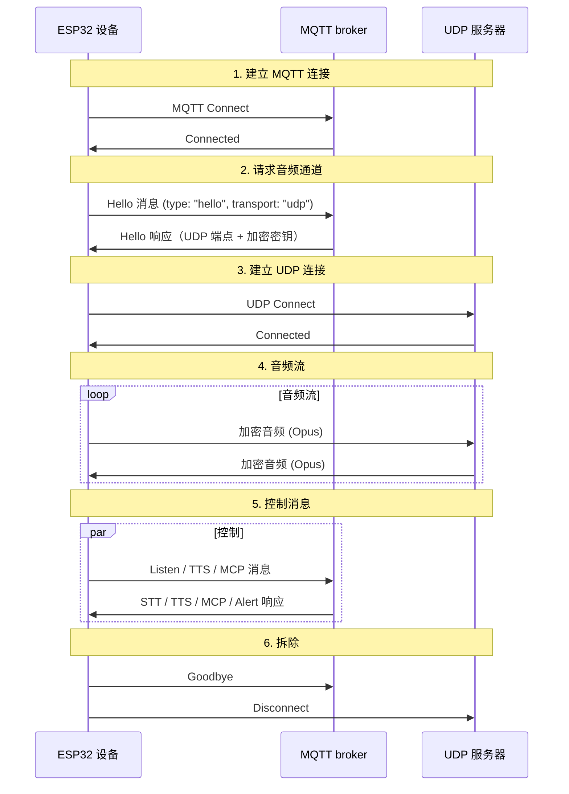
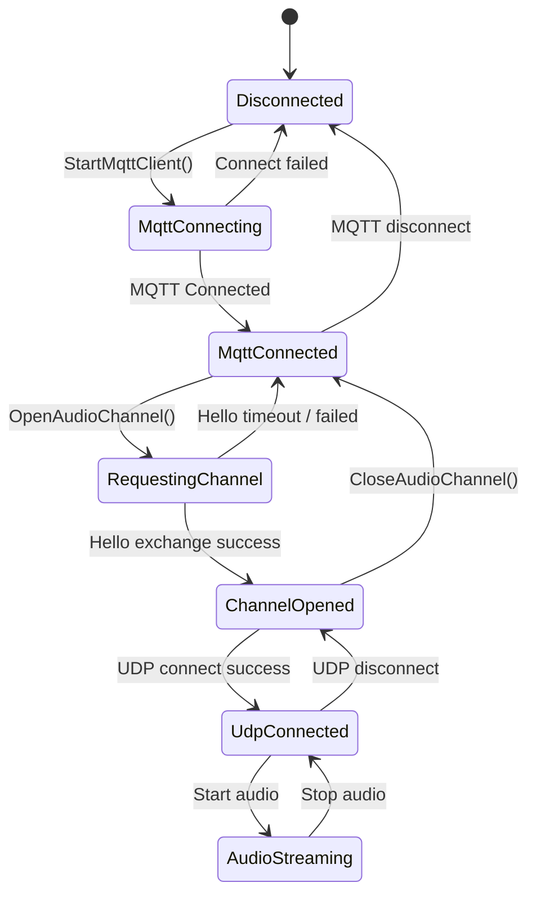

# MQTT + UDP 混合通信协议

本文档描述设备与服务器之间使用的 MQTT + UDP 混合协议，基于当前实现：MQTT 承载控制消息，UDP 承载实时音频。

---

## 1. 概述

该协议使用两个通道：

- **MQTT** —— 控制消息、状态同步，JSON 负载。
- **UDP** —— 实时音频，加密。

### 1.1 主要特性

- **双通道设计** —— 控制与数据分离，音频低延迟。
- **加密传输** —— UDP 音频使用 AES-CTR 加密。
- **序列号** —— 防重放、防乱序。
- **自动重连** —— MQTT 断线自动重连。

---

## 2. 端到端流程



---

## 3. MQTT 控制通道

### 3.1 连接

设备使用以下参数连接 broker：
- **端点** —— broker 主机和端口。
- **Client ID** —— 设备标识。
- **用户名 / 密码** —— 凭据。
- **Keep Alive** —— 心跳间隔（默认 240 秒）。

### 3.2 Hello 交换

#### 3.2.1 设备 → 服务器

```json
{
  "type": "hello",
  "version": 3,
  "transport": "udp",
  "features": {
    "mcp": true,
    "aec": true,
    "glyph_push": true
  },
  "text_font": {
    "bundle": "noto-v1",
    "charset": "common",
    "size": 20,
    "bpp": 4
  },
  "audio_params": {
    "format": "opus",
    "sample_rate": 16000,
    "channels": 1,
    "frame_duration": 60
  }
}
```

`features.mcp` 恒被设置；启用 `CONFIG_USE_SERVER_AEC` 时设置 `features.aec`。
`features.glyph_push` 和 `text_font` 宣告共享的动态文本字形扩展。

#### 3.2.2 服务器 → 设备

```json
{
  "type": "hello",
  "transport": "udp",
  "session_id": "xxx",
  "audio_params": {
    "format": "opus",
    "sample_rate": 24000,
    "channels": 1,
    "frame_duration": 60
  },
  "udp": {
    "server": "192.168.1.100",
    "port": 8888,
    "key": "0123456789ABCDEF0123456789ABCDEF",
    "nonce": "0123456789ABCDEF0123456789ABCDEF"
  }
}
```

字段说明：
- `udp.server` —— UDP 服务器地址。
- `udp.port` —— UDP 服务器端口。
- `udp.key` —— AES 密钥，十六进制编码。
- `udp.nonce` —— AES nonce，十六进制编码。

### 3.3 JSON 消息类型

#### 3.3.1 设备 → 服务器

1. **Listen**
   ```json
   {
     "session_id": "xxx",
     "type": "listen",
     "state": "start",
     "mode": "manual"
   }
   ```

2. **Abort**
   ```json
   {
     "session_id": "xxx",
     "type": "abort",
     "reason": "wake_word_detected"
   }
   ```

3. **MCP**
   ```json
   {
     "session_id": "xxx",
     "type": "mcp",
     "payload": {
       "jsonrpc": "2.0",
       "id": 1,
       "result": {}
     }
   }
   ```

4. **Goodbye**
   ```json
   {
     "session_id": "xxx",
     "type": "goodbye"
   }
   ```

#### 3.3.2 服务器 → 设备

语义与 WebSocket 协议一致。支持的类型：
- **STT** —— 语音识别结果。
- **TTS** —— TTS 生命周期（`start`、`stop`、`sentence_start`）。
- **LLM** —— 更新 UI 情绪。
- **MCP** —— IoT 控制。
- **System** —— 系统控制，如 `"command": "reboot"`。
- **Alert** —— 在 UI 上显示告警；字段：`status`、`message`、`emotion`。
- **Goodbye** —— 服务器主动关闭音频会话。设备直接关闭 UDP 通道，不再发送自己的 goodbye。
- **Custom**（可选，通过 `CONFIG_RECEIVE_CUSTOM_MESSAGE` 启用）。

告警示例：
```json
{
  "session_id": "xxx",
  "type": "alert",
  "status": "Warning",
  "message": "Battery low",
  "emotion": "sad"
}
```

---

## 4. UDP 音频通道

### 4.1 建立通道

设备收到 MQTT hello 响应后：
1. 解析 UDP 主机和端口。
2. 解析 AES 密钥和 nonce。
3. 初始化 AES-CTR 上下文。
4. 打开 UDP socket。

### 4.2 音频包格式

#### 4.2.1 加密音频包

```
|type 1B|flags 1B|payload_len 2B|ssrc 4B|timestamp 4B|sequence 4B|
|payload payload_len 字节|
```

字段说明：
- `type`：包类型，恒为 `0x01`。
- `flags`：标志位，目前未使用。
- `payload_len`：负载长度（网络字节序）。
- `ssrc`：同步源标识。
- `timestamp`：时间戳（网络字节序）。
- `sequence`：序列号（网络字节序）。
- `payload`：加密的 Opus 音频数据。

#### 4.2.2 加密

使用 **AES-CTR**：
- **密钥（Key）**：128 位，由服务器提供。
- **Nonce**：128 位，由服务器提供。
- **计数器（Counter）**：由时间戳和序列号构成。

### 4.3 序列号管理

- **发送方**：`local_sequence_` 单调递增。
- **接收方**：`remote_sequence_` 校验连续性。
- **防重放**：序列号低于期望值的包被丢弃。
- **容错**：小间隙记录为警告但仍然接收。

### 4.4 错误处理

1. **解密失败** —— 记录错误并丢弃该包。
2. **序列号跳变** —— 记录警告，继续处理该包。
3. **畸形包** —— 记录错误并丢弃。

---

## 5. 状态管理

### 5.1 连接状态



### 5.2 状态检查

设备通过以下代码判断音频通道是否可用：
```cpp
bool IsAudioChannelOpened() const {
    return udp_ != nullptr && !error_occurred_ && !IsTimeout();
}
```

---

## 6. 配置参数

### 6.1 MQTT 设置

从存储读取：
- `endpoint` —— broker 地址。
- `client_id` —— 客户端标识。
- `username` —— 用户名。
- `password` —— 密码。
- `keepalive` —— 保活间隔（默认 240 秒）。
- `publish_topic` —— 发布主题。

### 6.2 音频参数

- **格式**：Opus
- **采样率**：设备 16 kHz / 服务器 24 kHz
- **声道**：1（单声道）
- **帧时长**：60 毫秒

---

## 7. 错误处理与重连

### 7.1 MQTT 重连

- 连接失败自动重试。
- 可选的错误上报。
- 断开时执行清理。

### 7.2 UDP 连接

- 无自动重试；依赖通过 MQTT 重新协商。
- 状态可随时查询。

### 7.3 超时

基础 `Protocol` 类提供超时检测：
- 默认超时：120 秒。
- 基于最近一个入包的时间。
- 超时后通道被标记为不可用。

---

## 8. 安全

### 8.1 传输加密

- **MQTT**：支持 TLS/SSL（8883 端口）。
- **UDP**：音频负载使用 AES-CTR。

### 8.2 身份认证

- **MQTT**：用户名 / 密码。
- **UDP**：密钥经 MQTT 通道分发。

### 8.3 防重放

- 单调递增的序列号。
- 过期包被丢弃。
- 校验时间戳。

---

## 9. 性能说明

### 9.1 并发

互斥锁保护 UDP 连接：
```cpp
std::lock_guard<std::mutex> lock(channel_mutex_);
```

### 9.2 内存管理

- 网络对象动态创建和销毁。
- 音频包用智能指针管理。
- 加密上下文及时释放。

### 9.3 网络优化

- UDP 连接复用。
- 合理的包大小。
- 序列连续性检查。

---

## 10. 与 WebSocket 的对比

| 特性 | MQTT + UDP | WebSocket |
|---------|------------|-----------|
| 控制通道 | MQTT | WebSocket |
| 音频通道 | UDP（加密） | WebSocket（二进制） |
| 延迟 | 低（UDP） | 中 |
| 可靠性 | 中 | 高 |
| 复杂度 | 高 | 低 |
| 加密 | AES-CTR | TLS |
| 防火墙友好性 | 低 | 高 |

---

## 11. 部署说明

### 11.1 网络

- 确保 UDP 端口可达。
- 相应配置防火墙规则。
- 必要时规划 NAT 穿透。

### 11.2 服务器基础设施

- MQTT broker 配置。
- UDP 服务器部署。
- 密钥管理。

### 11.3 监控

- 连接成功率。
- 音频传输延迟。
- 丢包率。
- 解密失败次数。

---

## 12. 总结

MQTT + UDP 混合协议通过以下手段实现高效的音频通信：

- **分离式架构** —— 控制与数据通道分离、职责清晰。
- **加密** —— AES-CTR 保护音频负载。
- **序列号管理** —— 防止重放和乱序。
- **自动恢复** —— MQTT 故障自动重连。
- **性能** —— UDP 保持音频低延迟。

该协议非常适合低延迟语音交互，代价是网络复杂度高于纯 WebSocket。

---

**文档最新修改时间：** 2026-10-09
