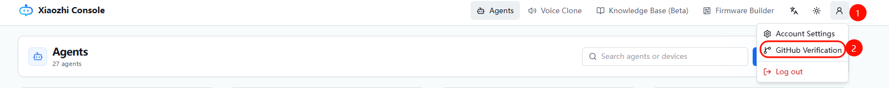
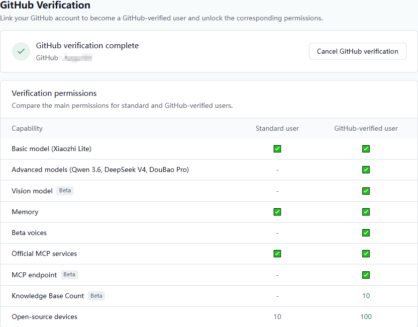

# 小智 AI 开发者认证

## 快速入口

直接进入开发者认证页面：<https://xiaozhi.me/console/developer-auth>

## 开发者权益

完成认证后，开发者可以解锁更多大语言模型和更高的配额：

| 类别 | 功能 | 开源用户 | 开发者 |
|---|---|---|---|
| **语言模型** | 小智 Lite | ✔ | ✔ |
| | DeepSeek（量化版） | ✔ | ✔ |
| | 通义千问 Qwen 3 | – | ✔ |
| | DeepSeek（完整版） | – | ✔ |
| | 豆包 | – | ✔ |
| | GLM 4.7（beta） | – | ✔（限时免费） |
| **视觉模型** | 视觉模型 | ✔（限时免费） | ✔（限时免费） |
| **记忆类型** | 无记忆 | ✔ | ✔ |
| | 短期记忆 | ✔ | ✔ |
| | 长期记忆 | ✔（限时免费） | ✔（限时免费） |
| **其他** | 可绑定的开源设备数 | 10 | 100 |
| | 知识库数量 | 1 | 10 |
| | 每个知识库文档数 | 1 | 10 |
| | Beta MCP 服务 | – | ✔（限时免费） |

## 认证流程

**第 1 步：** 点击上方链接，或登录 <https://xiaozhi.me/> 后点击右上角账号昵称。

**第 2 步：** 点击 **绑定 GitHub 账号（Bind GitHub Account）**。

**第 3 步：** GitHub 账号绑定成功后，所有模型和功能全部解锁。

