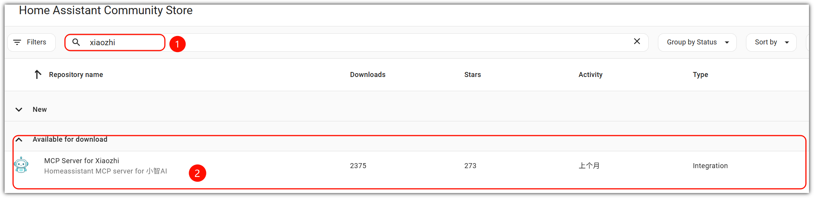
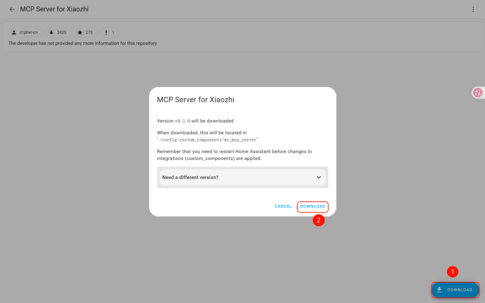
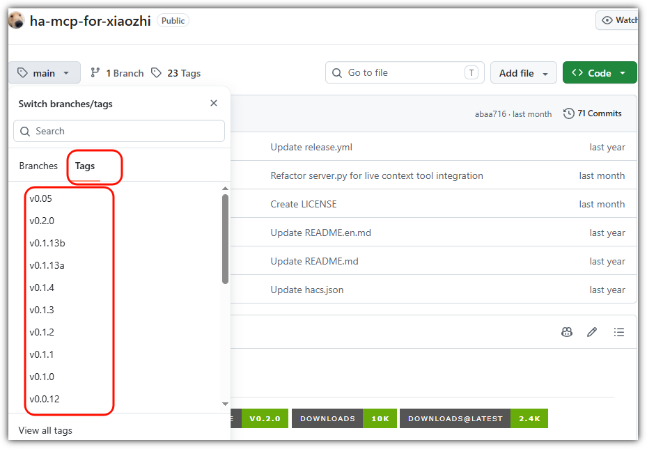
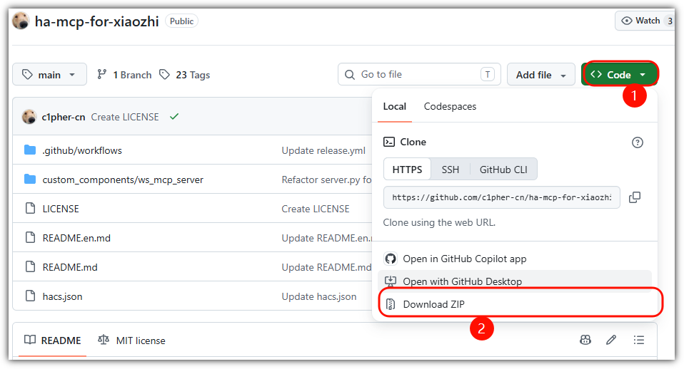
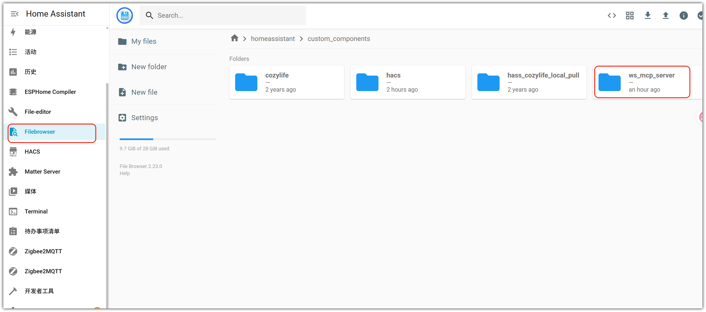
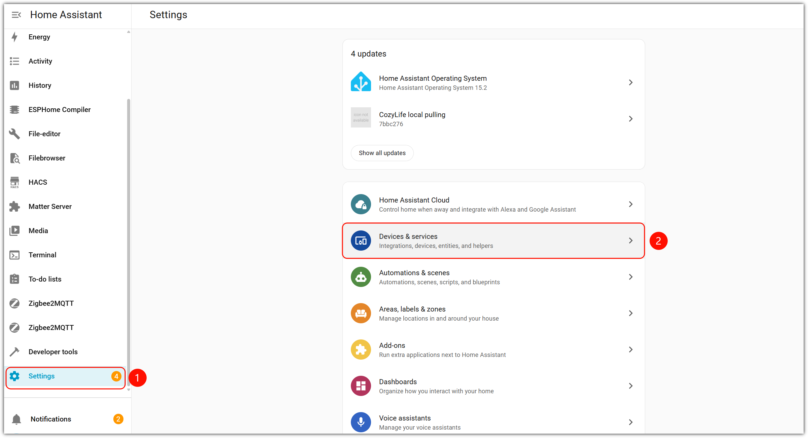
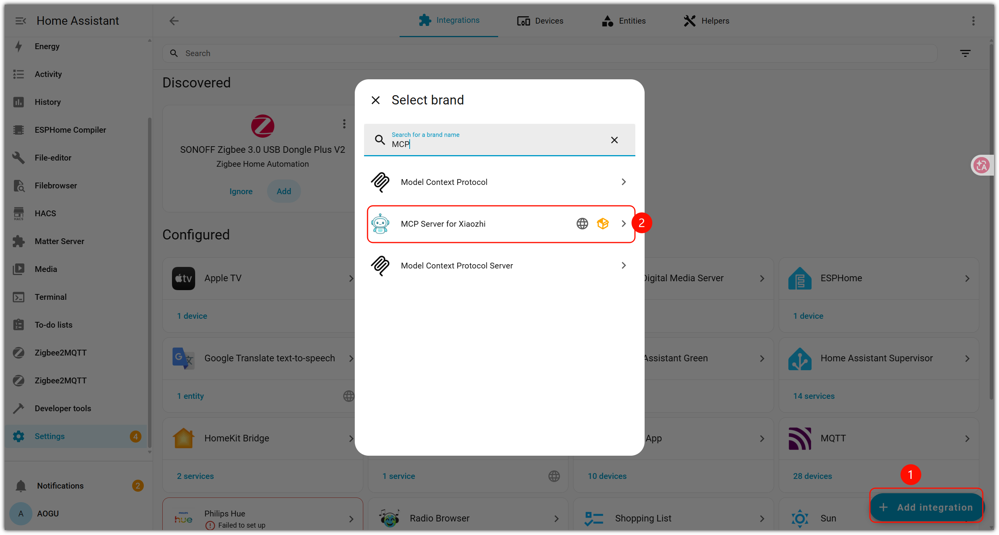
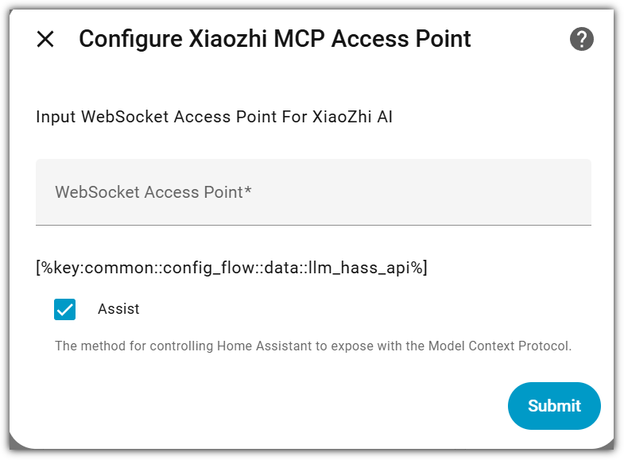
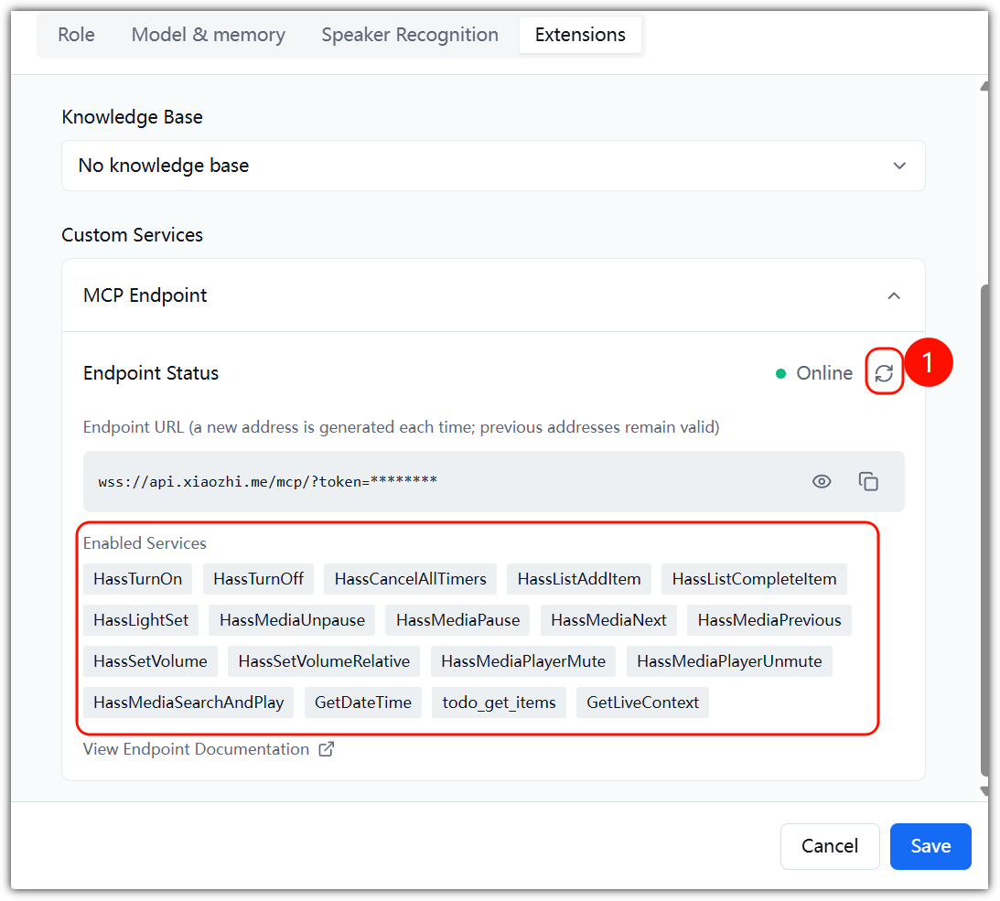

# ha-mcp-for-xiaozhi操作指南

> 适用固件：Albee v2.0.9 ｜ 适用对象：开发者

ha-mcp-for-xiaozhi官方文档：[ha-mcp-for-xiaozhi](https://github.com/c1pher-cn/ha-mcp-for-xiaozhi/blob/main/README.en.md)

## 如何安装

### 在线安装

> [!IMPORTANT]
>
> 确保 Home Assistant 中安装了 HACS

1. 打开 HACS，搜索 xiaozhi 或 ha-mcp-for-xiaozhi

2. 下载组件

 

3. 重启 Home Assistant

### 离线安装

1. 访问：[ha-mcp-for-xiaozhi](https://github.com/c1pher-cn/ha-mcp-for-xiaozhi)
2. 选择对应的版本

3. 点击下载

4. 解压并上传ws_mcp_server这个文件夹到homeassistant/custom_components

> [!NOTE]
>
> 可使用Filebrower上传，在设置->加载项中添加

5. 重启 Home Assistant

## 启用插件

1. 依次点击：设置 -> 设备与服务 -> 添加集成 -> 搜索“MCP” > 查找 Xiaozhi 的 MCP 服务器

2. 点击"下一步"，填写小智 MCP 接入点地址，查看[如何获取MCP接入点地址](./如何获取MCP接入点地址.md)

3. 配置完成！等一下，去小智的接入点页面，点击刷新查看

## 如何使用

重启完成后可以通过和Albee对话，语音控制比如：

~~~~
“帮我查看Home Assistant中的设备”
“帮我打开Home Assistant中的设备x”
~~~~

### 如何公开设备

> [!IMPORTANT]
>
> 需要先公开（添加）你 Home Assistant 中已有的设备，才能通过语音去控制 —— 步骤见[如何公开 Home Assistant 设备](./如何公开Home-Assistant设备.md)。

### 调试说明

1. 尽量使用最新版本的homeassistant，单单看5月版本跟3月版本提供的工具就有明显差异

2. 调试时未达到预期，优先看小智的聊天记录，看看小智对这句指令如何处理的，是否有调用homeassistant的工具。灯光控制是已知的易冲突点（小智同时能看到内置灯组工具与 HA 工具）：当前固件已为所有内置灯控工具加入**平台路由条款**——仅当用户明确点名 Home Assistant 时才使用外部平台工具，否则一律走本机控制；`control_group` 在 HA 报"实体不存在"时还会先核对分组名并回退本机，误路由问题已大幅缓解。若希望小智默认使用 HA 灯光，也可在设备网页 `http://设备IP/mcp` 关闭内置灯组工具，让小智改用 Home Assistant 侧工具；开关在新对话中生效（参见[MCP控制使用指南](./MCP控制使用指南.md)）。音乐控制的冲突仍待服务端支持内置工具选择后解决。

3. 如果流程正确的调用了ha内置的function，可以打开本插件的调试日志再去观测实际的执行情况

## 常见问题

- **MCP集成错误**：需要确保HomeAssistant是最新的版本
- **可用工具少**：需要暴露你的实体设备（见[如何公开 Home Assistant 设备](./如何公开Home-Assistant设备.md)）
- **控制不了设备**：确保你已经公开你的设备（见[如何公开 Home Assistant 设备](./如何公开Home-Assistant设备.md)）

## 注意事项

本项目内置了一些MCP工具，比如灯光控制MCP工具[灯光控制指南](./灯光控制指南.md)，所以通过Albee语音在控制HomeAssistant的灯具时需要指明是HASS里面的设备

---

**文档最新修改时间：** 2026-11-23