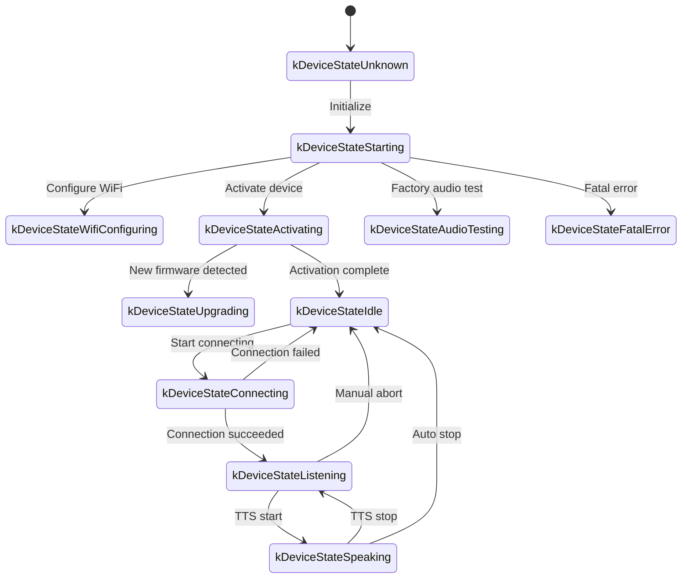
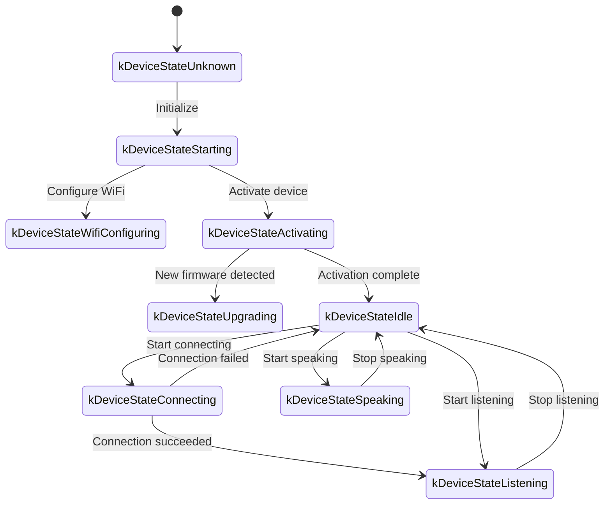

# WebSocket 通信协议

本文档基于当前代码描述设备与服务器之间的 WebSocket 通信协议。实现服务器时，请与实际实现相互印证。

---

## 1. 整体流程

1. **设备初始化**
   - 设备启动并初始化 `Application`：
     - 初始化音频编解码器、显示屏、LED 等。
     - 连接网络。
     - 创建实现 `Protocol` 接口的 WebSocket 协议实例（`WebsocketProtocol`）。
   - 进入主循环等待事件（音频输入、音频输出、定时任务等）。

2. **打开 WebSocket 连接**
   - 当设备需要开始语音会话（唤醒、按键等）时，调用 `OpenAudioChannel()`：
     - 从设置中读取 WebSocket URL。
     - 设置请求头（`Authorization`、`Protocol-Version`、`Device-Id`、`Client-Id`）。
     - 调用 `Connect()` 建立 WebSocket 连接。

3. **设备发送 "hello" 消息**
   - 连接建立后，设备发送一条 JSON 消息。示例：
   ```json
   {
     "type": "hello",
     "version": 1,
     "features": {
       "mcp": true,
       "aec": true,
       "glyph_push": true
     },
     "text_font": {
       "bundle": "noto-v1",
       "charset": "common",
       "size": 20,
       "bpp": 4
     },
     "transport": "websocket",
     "audio_params": {
       "format": "opus",
       "sample_rate": 16000,
       "channels": 1,
       "frame_duration": 60
     }
   }
   ```
   - `features` 为可选项，由编译期配置生成。例如 `"mcp": true` 表示设备支持 MCP，`"aec": true` 在启用 `CONFIG_USE_SERVER_AEC` 时发出。
   - `"glyph_push": true` 和 `text_font` 宣告可选的动态文本字形扩展。参见[动态文本字形推送扩展](glyph-push.md)。
   - `frame_duration` 与 `OPUS_FRAME_DURATION_MS` 一致（通常 60 毫秒）。

4. **服务器回复 "hello"**
   - 设备等待 `"type"` 为 `"hello"` 且 `"transport"` 为 `"websocket"` 的 JSON 消息。
   - 服务器可携带 `session_id`；设备会将其保存。
   - 示例：
   ```json
   {
     "type": "hello",
     "transport": "websocket",
     "session_id": "xxx",
     "audio_params": {
       "format": "opus",
       "sample_rate": 24000,
       "channels": 1,
       "frame_duration": 60
     }
   }
   ```
   - 如果 `transport` 匹配，设备将音频通道标记为已打开。
   - 如果超时（默认 10 秒）内未收到有效 hello，视为连接失败，触发网络错误回调。

5. **后续交互**
   - 双向传递两类数据：
     1. **二进制音频数据**（Opus 编码）
     2. **文本 JSON 消息**（聊天状态、TTS/STT 事件、MCP 消息等）

   - 在代码中，接收回调按如下方式分流：
     - `OnData(...)`：
       - 若 `binary` 为 `true`，将负载视为一个 Opus 帧并解码。
       - 若 `binary` 为 `false`，将负载解析为 JSON 并按 `type` 分发。

     - 当服务器或网络断开时，`OnDisconnected()` 触发：
       - 设备调用 `on_audio_channel_closed_()`，最终回到空闲状态。

6. **关闭 WebSocket 连接**
   - 设备想结束会话时，调用 `CloseAudioChannel()` 拆除 socket 并回到空闲。
   - 服务器先关闭 socket 时，同样走这条回调链。

---

## 2. 常用请求头

建立 WebSocket 连接时，设备设置以下请求头：

- `Authorization`：访问令牌，通常格式为 `"Bearer <token>"`。
- `Protocol-Version`：协议版本号，与 hello 消息中的 `version` 字段一致。
- `Device-Id`：设备物理 MAC 地址。
- `Client-Id`：软件生成的 UUID（擦除 NVS 或整体重刷固件时重置）。

这些请求头随 WebSocket 握手发送；服务器可用于身份认证或记录。

---

## 3. 二进制协议版本

设备支持多个二进制协议版本，由设置中的 `version` 字段选择：

### 3.1 版本 1（默认）
裸 Opus 帧，无额外元数据。WebSocket 层本身已区分文本帧与二进制帧。

### 3.2 版本 2
使用 `BinaryProtocol2` 结构：
```c
struct BinaryProtocol2 {
    uint16_t version;        // 协议版本
    uint16_t type;           // 消息类型（0：OPUS，1：JSON）
    uint32_t reserved;       // 保留
    uint32_t timestamp;      // 毫秒时间戳（可用于服务器端 AEC）
    uint32_t payload_size;   // 负载字节数
    uint8_t payload[];       // 负载
} __attribute__((packed));
```

### 3.3 版本 3
使用 `BinaryProtocol3` 结构：
```c
struct BinaryProtocol3 {
    uint8_t type;            // 消息类型
    uint8_t reserved;        // 保留
    uint16_t payload_size;   // 负载大小
    uint8_t payload[];       // 负载
} __attribute__((packed));
```

---

## 4. JSON 消息结构

WebSocket 文本帧承载 JSON。最常见的 `"type"` 值及其语义如下。未列出的字段可能是实现特定的或可选的。

### 4.1 设备 → 服务器

1. **Hello**
   - 连接建立后发送一次；宣告设备参数。
   - 示例：
     ```json
     {
       "type": "hello",
       "version": 1,
       "features": {
         "mcp": true,
         "aec": true
       },
       "transport": "websocket",
       "audio_params": {
         "format": "opus",
         "sample_rate": 16000,
         "channels": 1,
         "frame_duration": 60
       }
     }
     ```

2. **Listen**
   - 告知服务器设备开始或停止麦克风采集。
   - 常见字段：
     - `"session_id"`：会话标识。
     - `"type": "listen"`
     - `"state"`：`"start"`、`"stop"` 或 `"detect"`（检测到唤醒词）。
     - `"mode"`：`"auto"`、`"manual"` 或 `"realtime"`。
   - 示例（开始听取）：
     ```json
     {
       "session_id": "xxx",
       "type": "listen",
       "state": "start",
       "mode": "manual"
     }
     ```

3. **Abort**
   - 中止当前 TTS 播放或语音通道。
   - 示例：
     ```json
     {
       "session_id": "xxx",
       "type": "abort",
       "reason": "wake_word_detected"
     }
     ```
   - `reason` 可以是 `"wake_word_detected"` 或其他实现定义的值。

4. **唤醒词检测**
   - 本地唤醒词检测器触发时由设备发送。
   - 在此消息之前可以流式发送包含唤醒词的 Opus 音频，让服务器做声纹校验。
   - 示例：
     ```json
     {
       "session_id": "xxx",
       "type": "listen",
       "state": "detect",
       "text": "Hi XiaoZhi"
     }
     ```

5. **MCP**
   - 推荐的 IoT 控制通道。设备能力发现与工具调用全部通过 `type: "mcp"` 消息进行，其 `payload` 为 JSON-RPC 2.0（参见 [MCP 协议文档](./mcp-protocol.md)）。
   - 设备到服务器的响应示例：
     ```json
     {
       "session_id": "xxx",
       "type": "mcp",
       "payload": {
         "jsonrpc": "2.0",
         "id": 1,
         "result": {
           "content": [
             { "type": "text", "text": "true" }
           ],
           "isError": false
         }
       }
     }
     ```

---

### 4.2 服务器 → 设备

1. **Hello**
   - 握手确认。
   - 必须包含 `"type": "hello"` 和 `"transport": "websocket"`。
   - 可包含 `audio_params`，表示服务器期望的音频参数 / 与设备约定的规范集合。
   - 可包含 `session_id`，设备会记录。
   - 收到后，设备置"音频通道打开"事件。

2. **STT**
   - `{"session_id": "xxx", "type": "stt", "text": "..."}`
   - 用户话语的语音识别结果。通常先显示在屏幕上，再进入回复。

3. **LLM**
   - `{"session_id": "xxx", "type": "llm", "emotion": "happy", "text": "😀"}`
   - 让设备更新 UI 上的情绪 / 表情。

4. **TTS**
   - `{"session_id": "xxx", "type": "tts", "state": "start"}`：服务器即将推送 TTS 音频。设备转入说话状态。
   - `{"session_id": "xxx", "type": "tts", "state": "stop"}`：本段 TTS 结束。
   - `{"session_id": "xxx", "type": "tts", "state": "sentence_start", "text": "..."}`：在 UI 上显示当前句子（例如字幕显示）。

5. **MCP**
   - 服务器发送 IoT 相关命令或接收工具调用结果。`payload` 结构遵循 JSON-RPC 2.0。
   - 服务器到设备的 `tools/call` 示例：
     ```json
     {
       "session_id": "xxx",
       "type": "mcp",
       "payload": {
         "jsonrpc": "2.0",
         "method": "tools/call",
         "params": {
           "name": "self.light.set_rgb",
           "arguments": { "r": 255, "g": 0, "b": 0 }
         },
         "id": 1
       }
     }
     ```

6. **System**
   - 系统级控制，常用于远程升级 / 管理。
   - 示例：
     ```json
     {
       "session_id": "xxx",
       "type": "system",
       "command": "reboot"
     }
     ```
   - 支持的命令：
     - `"reboot"`：重启设备。

7. **Alert**
   - 让设备显示告警并播放提示音。在 `Application::OnIncomingJson` 中处理。
   - 示例：
     ```json
     {
       "session_id": "xxx",
       "type": "alert",
       "status": "Warning",
       "message": "Battery low",
       "emotion": "sad"
     }
     ```
   - 字段：
     - `status`：屏幕上显示的短标题。
     - `message`：详细消息。
     - `emotion`：告警期间显示的情绪（如 `"sad"`、`"neutral"`）。

8. **Custom**（可选）
   - 启用 `CONFIG_RECEIVE_CUSTOM_MESSAGE` 后可用。
   - 示例：
     ```json
     {
       "session_id": "xxx",
       "type": "custom",
       "payload": {
         "message": "anything you want"
       }
     }
     ```

9. **二进制音频帧**
   - 服务器以二进制帧推送 Opus 编码音频时，设备解码并播放。
   - 设备处于 `listening`（听取）状态时收到的帧会被丢弃，以避免与麦克风音频流冲突。

---

## 5. 音频编解码

1. **设备上传麦克风音频**
   - 经可选的 AEC / NR / AGC 处理后，音频以 Opus 编码并作为二进制帧发送。
   - 依据协议版本不同，帧可以是裸 Opus（v1）或包裹在元数据结构中（v2/v3）。

2. **设备播放服务器音频**
   - 传入的二进制帧同样按 Opus 处理。
   - 设备解码后送音频输出。
   - 如采样率与设备输出不一致，解码后重采样。

---

## 6. 设备状态

### 6.1 主要状态

设备状态机定义在 `main/device_state.h`，包括：

- `kDeviceStateUnknown`
- `kDeviceStateStarting`
- `kDeviceStateWifiConfiguring`
- `kDeviceStateIdle`
- `kDeviceStateConnecting`
- `kDeviceStateListening`
- `kDeviceStateSpeaking`
- `kDeviceStateUpgrading`
- `kDeviceStateActivating`
- `kDeviceStateAudioTesting`    （产测 / 爬坡音频测试）
- `kDeviceStateFatalError`      （需要用户干预的不可恢复错误）

### 6.2 典型状态迁移

1. **Idle -> Connecting**
   - 由唤醒词或按键触发。设备调用 `OpenAudioChannel()`，建立 WebSocket 并发送 `"type":"hello"`。

2. **Connecting -> Listening**
   - 连接成功后调用 `SendStartListening(...)`，开始麦克风流式传输。

3. **Listening -> Speaking**
   - 服务器发送 `{"type":"tts","state":"start"}`；设备停止发送麦克风音频，播放传入的 TTS。

4. **Speaking -> Idle**
   - 服务器发送 `{"type":"tts","state":"stop"}`。启用自动继续时设备回到 Listening；否则回到 Idle。

5. **Listening / Speaking -> Idle**（中止）
   - `SendAbortSpeaking(...)` 或 `CloseAudioChannel()` 中断会话并关闭 WebSocket。

### 6.3 自动模式状态图



### 6.4 手动模式状态图



---

## 7. 错误处理

1. **连接失败**
   - 如果 `Connect(url)` 失败，或超时前未收到服务器 hello，调用 `on_network_error_()`，设备显示"无法连接"告警。

2. **服务器断开**
   - WebSocket 意外掉线时调用 `OnDisconnected()`：
     - 执行 `on_audio_channel_closed_()`。
     - 设备回到 Idle（或依据策略重试）。

---

## 8. 其他说明

1. **身份认证**
   - 设备提供 `Authorization: Bearer <token>`；服务器必须校验。
   - 令牌缺失或无效时，服务器可拒绝握手，或在会话中后期终止。

2. **会话范围**
   - 许多消息携带 `session_id`，在服务器并发处理多个交互时有用。

3. **音频负载**
   - 默认音频格式为 Opus，16 kHz 单声道。帧时长由 `OPUS_FRAME_DURATION_MS` 控制（通常 60 毫秒）。服务器下行可用 24 kHz 以获得更好的音乐播放效果。

4. **二进制协议版本选择**
   - 通过 `version` 设置项配置：
     - v1：裸 Opus
     - v2：元数据 + 时间戳（可用于服务器端 AEC）
     - v3：轻量头部
   - 该值会回显在 `Protocol-Version` 请求头和 hello 消息中。

5. **通过 MCP 进行 IoT 控制**
   - 所有 IoT 能力发现与控制都走 MCP（`type: "mcp"`）。旧版 `type: "iot"` 协议已废弃。
   - MCP 同时支持 WebSocket 和 MQTT，标准化程度和扩展性更好。
   - 详情参见 [MCP 协议文档](./mcp-protocol.md) 和 [MCP IoT 控制使用](./mcp-usage.md)。

6. **畸形 JSON**
   - 当 `type` 等必填字段缺失时，设备记录 `ESP_LOGE(TAG, "Missing message type, data: %s", data);` 并忽略该消息。

---

## 9. 消息流程示例

一个简化的双向交互：

1. **设备 → 服务器**（握手）
   ```json
   {
     "type": "hello",
     "version": 1,
     "features": {
       "mcp": true,
       "aec": true
     },
     "transport": "websocket",
     "audio_params": {
       "format": "opus",
       "sample_rate": 16000,
       "channels": 1,
       "frame_duration": 60
     }
   }
   ```

2. **服务器 → 设备**（握手确认）
   ```json
   {
     "type": "hello",
     "transport": "websocket",
     "session_id": "xxx",
     "audio_params": {
       "format": "opus",
       "sample_rate": 16000
     }
   }
   ```

3. **设备 → 服务器**（开始听取）
   ```json
   {
     "session_id": "xxx",
     "type": "listen",
     "state": "start",
     "mode": "auto"
   }
   ```
   设备开始流式发送二进制 Opus 帧。

4. **服务器 → 设备**（ASR 结果）
   ```json
   {
     "session_id": "xxx",
     "type": "stt",
     "text": "用户说的话"
   }
   ```

5. **服务器 → 设备**（TTS 开始）
   ```json
   {
     "session_id": "xxx",
     "type": "tts",
     "state": "start"
   }
   ```
   服务器随后推送二进制 Opus 帧供设备播放。

6. **服务器 → 设备**（TTS 结束）
   ```json
   {
     "session_id": "xxx",
     "type": "tts",
     "state": "stop"
   }
   ```
   设备停止播放，如无后续指令则回到空闲。

---

## 10. 总结

本协议通过 WebSocket 连接承载 JSON 文本和二进制 Opus 帧，实现音频流、TTS 播放、语音识别、设备状态管理、MCP 分发等。关键特性：

- **握手**：发送 `"type":"hello"` 并等待服务器回复。
- **音频通道**：双向 Opus 流，三种二进制封帧变体。
- **JSON 消息**：按 `"type"` 分发（TTS、STT、MCP、WakeWord、System、Alert、Custom 等）。
- **可扩展性**：JSON 中的附加字段、用于认证的额外请求头。

服务器与设备必须就每种消息类型的含义、时序和错误处理达成一致，会话才能顺畅进行。上文为集成、调试和扩展提供了基线。
