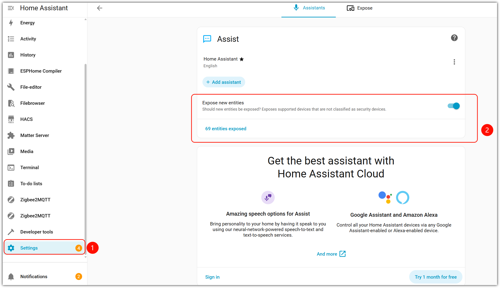
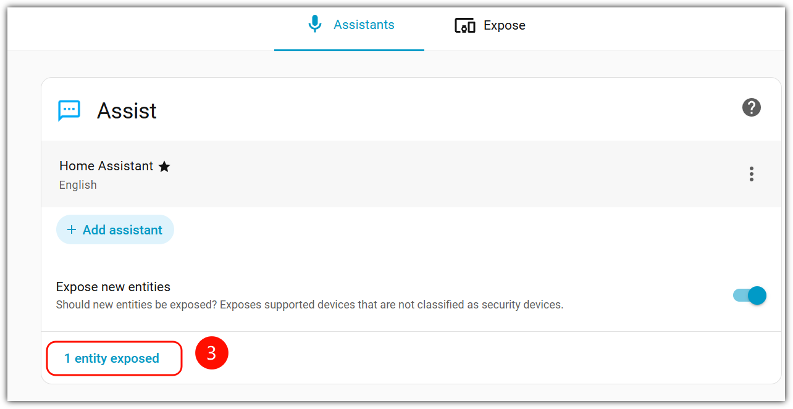
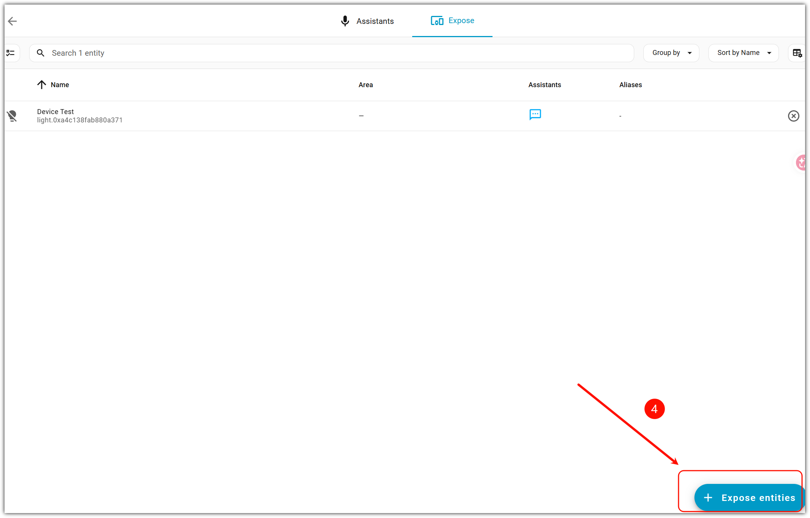

# 如何公开 Home Assistant 设备

> 适用固件：Albee v2.0.9 ｜ 适用对象：开发者

> [!IMPORTANT]
>
> **必须先按本文步骤公开（添加）你 Home Assistant 中已有的设备，Albee 才能通过语音（MCP）控制它们。** 未公开的设备对 MCP 不可见，也无法控制。

本文适用于通过 MCP 插件接入 Home Assistant 的所有场景，配套文档：[Home-Assistant集成指南](./Home-Assistant集成指南.md)、[ha-mcp-for-xiaozhi操作指南](./ha-mcp-for-xiaozhi操作指南.md)。

## 公开步骤

1. 暴露的工具取决于你公开给 Home Assistant 语音助手的实体的种类

```
设置 -> 语音助手 -> 公开
```



"语音助手 -> 公开"页面：



公开实体后可用的工具示例：



2. 公开后即可通过语音控制，例如"帮我打开 Home Assistant 中的客厅灯"

## 常见问题

- **可用工具少**：公开的实体设备越多、种类越全，可用的工具越多 —— 需要暴露你的实体设备
- **控制不了设备**：确保你已经公开你的设备

---

**文档最新修改时间：** 2026-11-12
