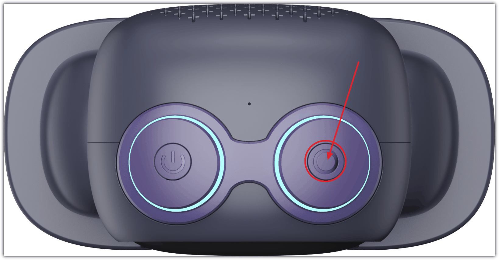
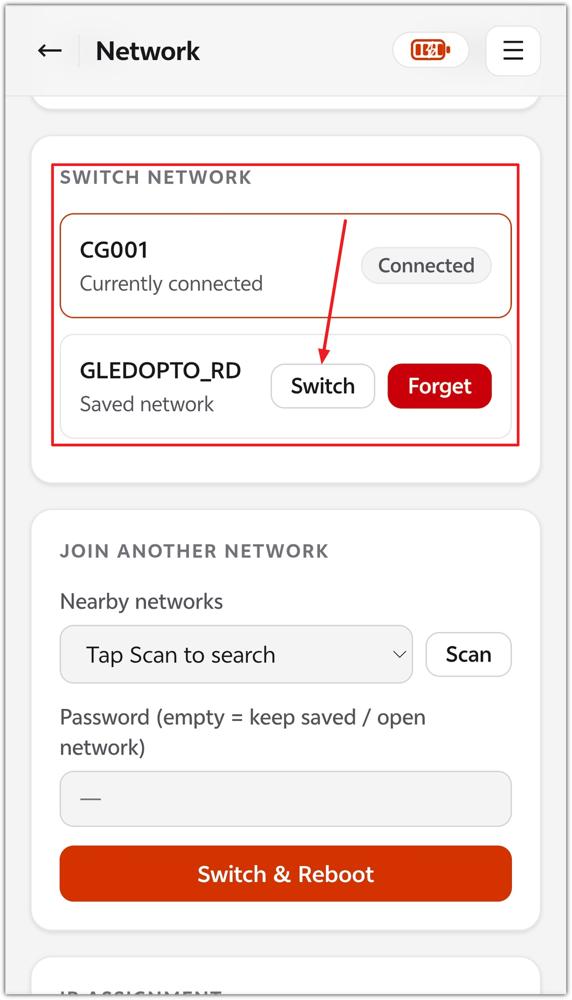
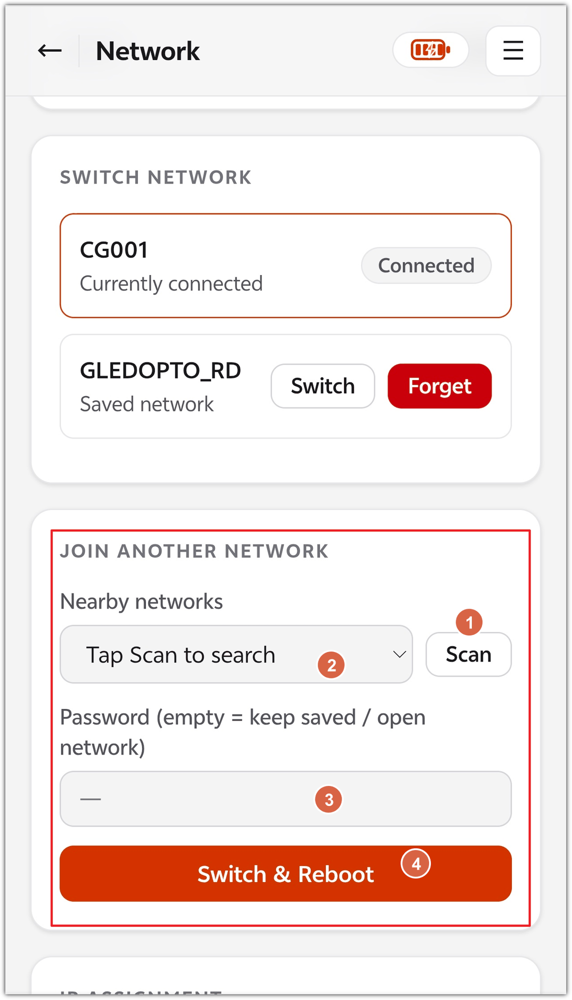

# 更换网络指南

## 一、通过按键切换

1. 重启设备

2. 当头顶LED 效果是蓝色滚动流水灯（或者重启后3秒内）单击一次Function Button

   

## 二、通过网页切换已保存的网络

1. 确保设备已激活已联网
2. 通过对话获取它的IP地址，然后用手机或者电脑连接到同一WIFI下（确保同一局域网）
3. 通过浏览器访问：http://<机器人IP>/network
4. 找到 SWITCH NETWORK 区块，点击非当前连接网络的 Switch 按钮

## 三、加入新网络（扫描）

1. 确保设备已激活已联网
2. 通过对话获取它的IP地址，然后用手机或者电脑连接到同一WIFI下（确保同一局域网）
3. 通过浏览器访问：http://<机器人IP>/network
4. 点 Scan 按钮手动扫描
5. 等下拉框出现结果
6. 选网络，密码框规则：

   - 开放网络：无需密码
   - 已保存网络：留空 = 沿用存储的密码；输入新密码 = 覆盖旧密码（这是改密码变了的路由器的唯一途径）
   - 全新网络：必须输入
7. 点 Switch & Reboot

---

**文档最新修改时间：** 2026-10-09
