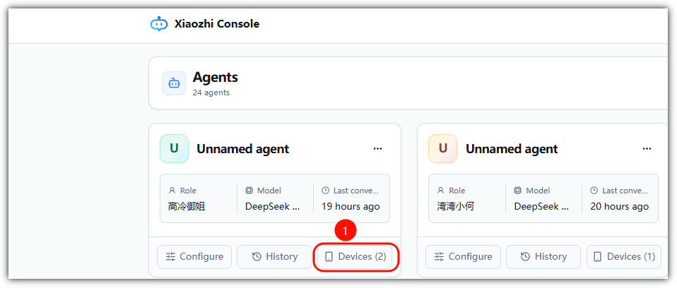
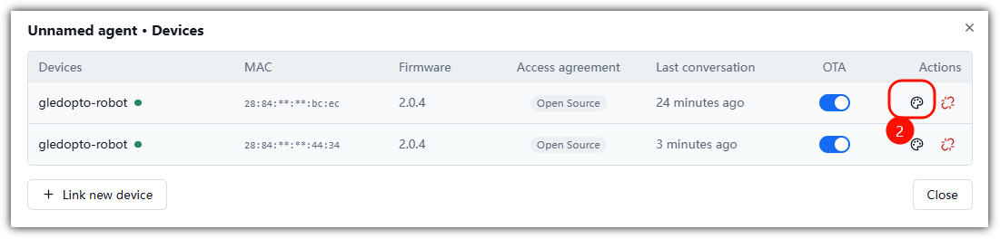
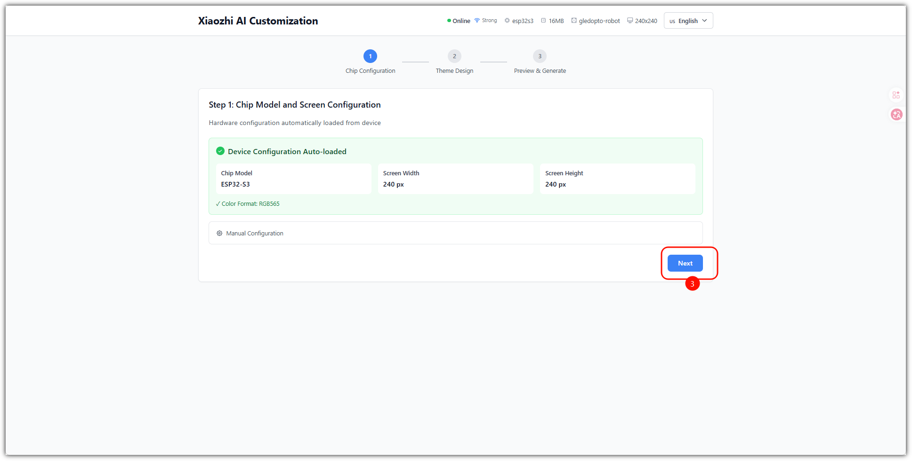
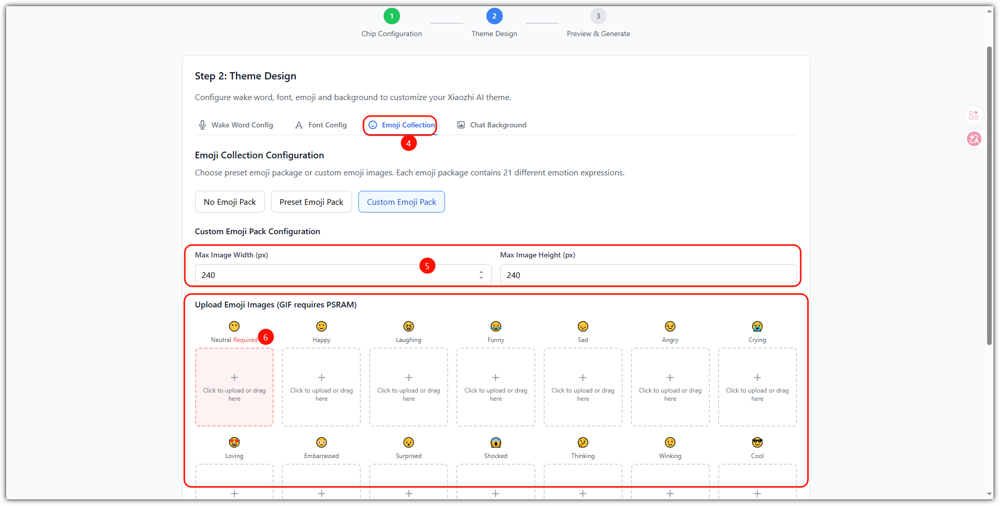
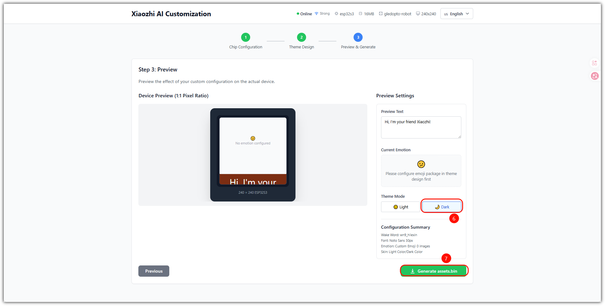
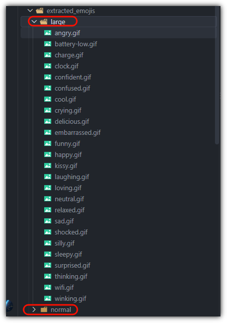

# 更改表情指南
> 适用固件：Albee v2.0.4 及以上 ｜ 适用对象：普通用户

## 一、通过小智后台

访问小智后台：https://xiaozhi.me/

## 二、代码编译修改

替换 ./extracted_emojis 下的.gif表情，然后重新编译即可

编译下载烧录查看：[固件编译教程](固件编译教程.md)

---

**文档最新修改时间：** 2026-09-10
