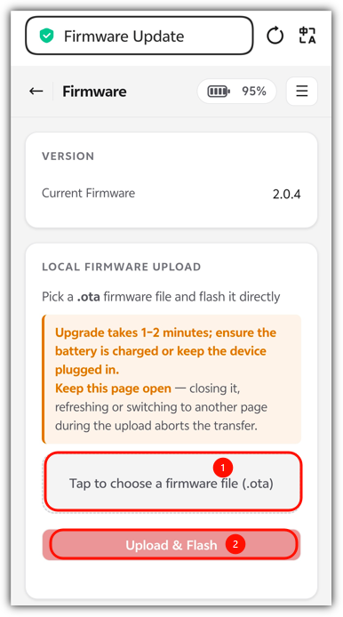

# 本地 OTA 升级指南

1. 确保设备已激活已联网
2. 通过对话获取它的IP地址，然后用手机或者电脑连接到同一WIFI下（确保同一局域网）
3. 通过浏览器访问：ip/update
4. 点击 “Tap to choose a firmware file (.ota)”
5. 上传Albee_xxx.ota文件
6. 点击Upload & Flash

---

**文档最新修改时间：** 2026-10-08