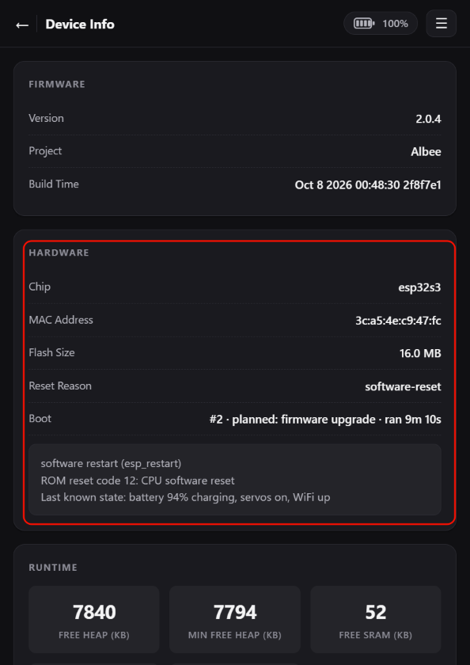

# 设备死机或重启问题反馈指南
> 适用固件：Albee v2.0.4 及以上 ｜ 适用对象：普通用户

如果设备无故死机或重启，请发送邮件至 [service@gledopto.com](mailto:service@gledopto.com)，并提供以下信息：

1. **故障发生时的情况**：设备当时处于什么状态？您进行了哪些操作？
2. **启动原因**：先获取设备 IP 地址（见[获取设备 IP 地址](./获取设备IP地址.md)），然后在浏览器中访问 `http://设备IP/info`，查看并提供启动原因（示例如下图）。注意：手机或者电脑需要保持和Albee在同一局域网下。**提供启动原因截图时，请不要重启/升级设备，需要在设备死机重启后的第一时间访问该网页获取该信息。**

3. **运行日志（如有）**：如果电脑上有串口助手，请用 Type-C 数据线连接 Albee，查看设备运行日志。如发现错误信息，请一并提供，便于排查问题。

---

**文档最新修改时间：** 2026-10-09

---

**官方网站：** <http://www.gledoptorobots.com>

**售后联系：** service@gledopto.com
