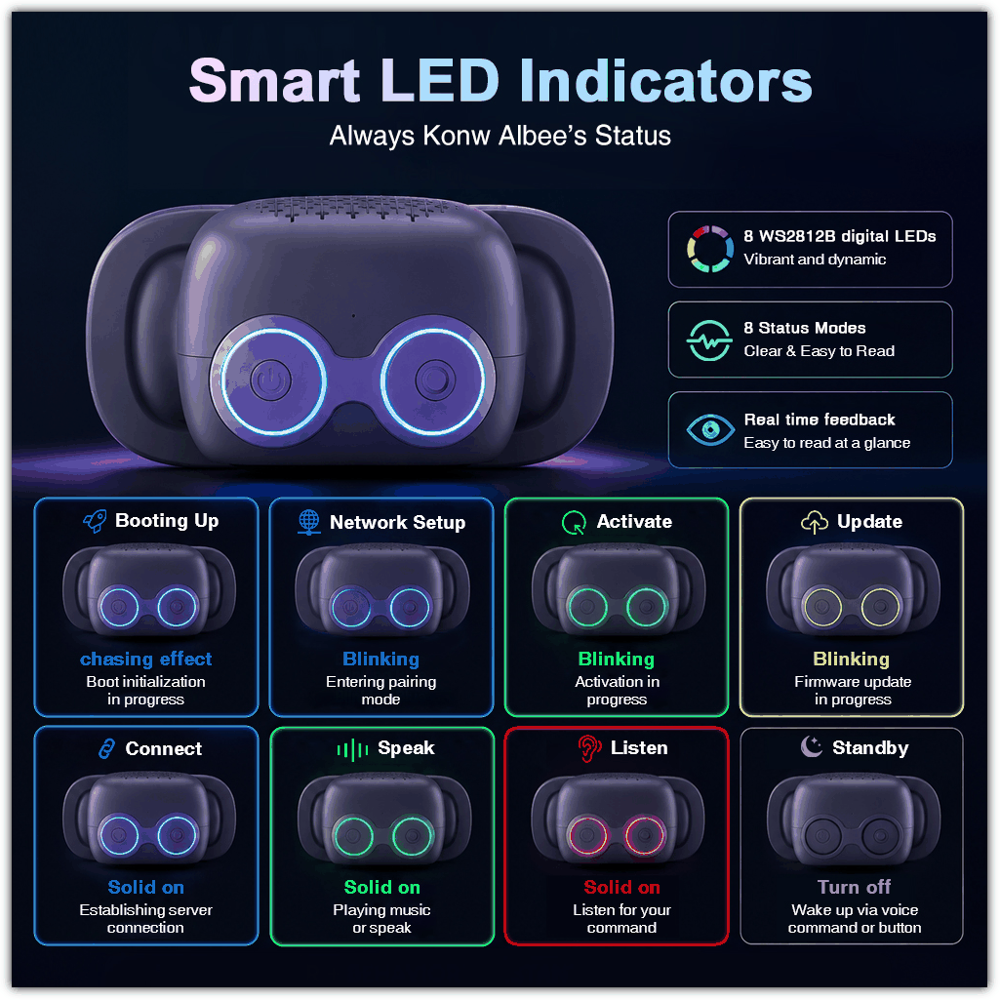

# 设备状态与指示灯
> 适用固件：Albee v2.0.5 ｜ 适用对象：开发者

## 一、状态总览

`DeviceState` 共 **11 种**，其中 **9 种有指示灯行为**（`device_state.h`）：

| DeviceState                   | 含义              | 指示灯                  |
| ----------------------------- | ----------------- | ----------------------- |
| `kDeviceStateUnknown`         | 未知（初始）      | **无**                  |
| `kDeviceStateStarting`        | 开机启动          | 有                      |
| `kDeviceStateWifiConfiguring` | 配网中（AP 模式） | 有                      |
| `kDeviceStateIdle`            | 待机空闲          | 有                      |
| `kDeviceStateConnecting`      | 连接服务器中      | 有                      |
| `kDeviceStateListening`       | 聆听中            | 有                      |
| `kDeviceStateSpeaking`        | 说话/播放中       | 有                      |
| `kDeviceStateUpgrading`       | OTA 升级中        | 有                      |
| `kDeviceStateActivating`      | 激活中            | 有                      |
| `kDeviceStateAudioTesting`    | 配网下的音频测试  | 有（与 Listening 共用） |
| `kDeviceStateFatalError`      | 致命错误          | **无**                  |

如下图所示

## 二、状态 → 灯效映射（出厂默认值）

| # | 页面名称 | 对应状态 | 默认灯效 | 默认颜色 |
| --- | --- | --- | --- | --- |
| 0 | Booting | `Starting` | Scroll（滚动） | 蓝 |
| 1 | Wi-Fi setup | `WifiConfiguring` | Blink（闪烁） | 蓝 |
| 2 | Idle | `Idle` | Fade out（渐灭） | （忽略颜色） |
| 3 | Connecting | `Connecting` | Solid（常亮） | 蓝 |
| 4 | Listening | `Listening`、`AudioTesting` | Solid（常亮） | 红 |
| 5 | Speaking | `Speaking` | Solid（常亮） | 绿 |
| 6 | Firmware update | `Upgrading` | Blink（闪烁） | 绿 |
| 7 | Activating | `Activating` | Blink（闪烁） | 绿 |

各状态的节奏与可改性：

| 页面名称 | 槽位 key | 节奏 | 效果/节奏可改 |
| --- | --- | --- | --- |
| Booting | `starting` | 100 ms/帧，亮段 3 颗 | 🔒 锁定 |
| Wi-Fi setup | `wifi_configuring` | 500 ms | 🔒 锁定 |
| Idle | `idle` | 50 ms/帧 | 可改颜色 |
| Connecting | `connecting` | — | 可改 |
| Listening | `listening` | — | 可改 |
| Speaking | `speaking` | — | 可改 |
| Firmware update | `upgrading` | 1000 ms | 🔒 锁定 |
| Activating | `activating` | 500 ms | 可改 |

行为解读：

- **Booting**：一段 3 颗的蓝色亮段绕环滚动，每帧前进 1 颗、帧周期 100 ms。
- **Wi-Fi setup**：蓝色 500 ms 方波闪烁（亮/灭各 500 ms）。
- **Idle**：把环上**当前显示的画面**每帧亮度减半直至全灭（50 ms/帧，约 0.4 s 熄灭），所以待机最终是**灭灯**。该效果不读取配置颜色。
- **Connecting**：蓝色常亮。
- **Listening / AudioTesting**：红色常亮。
- **Speaking**：绿色常亮。
- **Firmware update**：绿色 1000 ms 闪烁。节奏锁定为 1 s 是**硬件原因**——`esp_ota_write` 会成片关闭 flash cache，连带打断驱动 RMT 与 esp_timer 的中断；间隔太短看起来像"卡死"而不是"闪烁"。
- **Activating**：绿色 500 ms 闪烁。

> 颜色随**全局亮度**百分比缩放（预设色通道值 = 亮度% × 255 / 100；默认 15% ≈ 38）。

## 三、灯效类型

共 6 种，设置页可选（锁定槽除外）：

| 效果       | 名称     | 行为                                                         |
| ---------- | -------- | ------------------------------------------------------------ |
| `kSolid`   | Solid    | 单一平色常亮，动画定时器停止                                 |
| `kBlink`   | Blink    | 颜色 / 灭 的方波，`interval_ms` 为半周期                     |
| `kFadeOut` | Fade out | 将当前像素每帧亮度减半直至熄灭；**忽略配置颜色**；节奏固定 50 ms 不可调（"速度"实为每步衰减深度） |
| `kBreathe` | Breathe  | 配置颜色按 0 → 最亮 → 0 缩放呼吸（步长 3/帧，`interval_ms` 为帧周期） |
| `kScroll`  | Scroll   | 一段`length` 颗（1–7）的亮段沿环滚动，每帧前进 1 颗          |
| `kRainbow` | Rainbow  | 全员色相均匀铺满环并整体旋转；`interval_ms` 控制转速（一圈 ≈ 24 帧，50 ms 最快 ≈ 1.2 s/圈） |

---

**文档最新修改时间：** 2026-10-09

