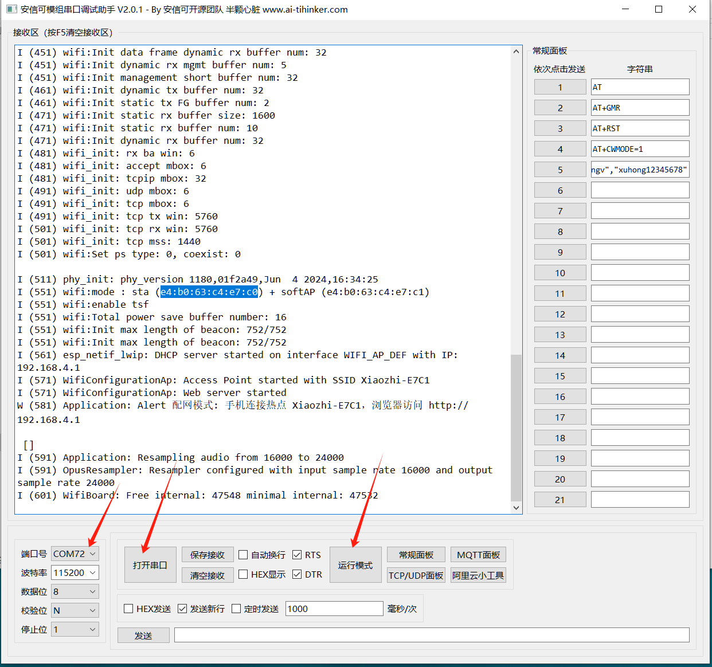

# Account & Device Issues

This page covers common account problems: not receiving the SMS verification code, forgetting your password or username, and unbinding a device.

## Cannot Receive the SMS Verification Code

Normally the verification code arrives within 5 minutes; for international phone numbers, please allow up to 10 minutes. If you still do not receive it, check whether your phone service is suspended or out of credit, or whether the message was intercepted by a third-party security app.

## Know the Username but Forgot the Password

- If a phone number is bound to your account, log in via SMS instead.
- If no phone number is bound, send an email with your **username** and **device ID** to <xiaozhi.ai@tenclass.com>.

Email subject format: `【Password Recovery, Username XXX, Device ID XXX】`

## Forgot Both Username and Password

- If a phone number is bound to your account, log in via SMS instead.
- If no phone number is bound, send an email with your **device ID** and **activation date** to <xiaozhi.ai@tenclass.com>.

Email subject format: `【Username Recovery, Device ID XXX, Activation Date XXX】`

## How to Get the Device ID and MAC Address

- **Device ID** — If your device is working, simply talk to it and ask it to tell you.
- **MAC address** — You need to download a serial port tool and read it from the serial log (see the appendix below).

## Device Already Bound to Another Account — How to Unbind

This usually happens when a dev kit or chip module was previously bound to someone else's account and was not unbound on the xiaozhi.me website before being returned or resold.

To unbind it, send an email to <xiaozhi.ai@tenclass.com> with the subject:

`【Unbind Device, Device ID XXX, MAC Address XXX】`

If you need to unbind multiple devices, download the template below, fill in the device IDs and MAC addresses, attach the completed spreadsheet to the email, and use the subject `【Unbind Device】`:

[Download the unbind template (xlsx)](../../assets/account-help/xiaozhi-device-unbind-template.xlsx)

## Appendix: How to View the MAC Address

1. Download the serial port tool: [Ai-Thinker Serial Tool V2.0.1](../../assets/account-help/aithinker-serial-tool-v2.0.1.exe)

2. Connect the dev board / finished device to your computer (if it has a power switch, make sure it is powered on). Open the serial tool with the default parameters (no adjustment needed), select your board's COM port, and click **Open Serial Port**. If no error is reported, click **Run Mode** to reboot the board and load the serial log.

3. In the serial log, find the line `wifi:mode : sta ( ... )` at around the **(550) ms** line — the value shown there (highlighted in blue in the screenshot below) is the MAC address.

---

**Last modified:** 2026-09-10
