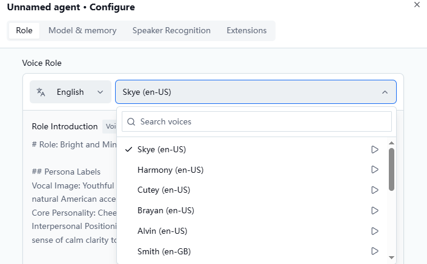
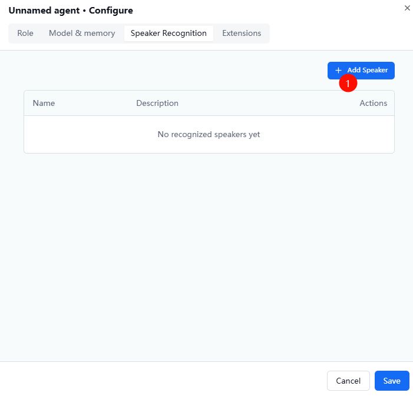

# Albee Desktop Robot FAQ

## Q1: How do I adjust Albee's volume?

**A:** Albee supports voice control for volume. Just tell Albee to set the volume to a specific level (1–100%), or simply say "turn the volume up / down a little".

## Q2: How do I reconfigure or switch the Wi-Fi?

**A:** Restart Albee. While the blue LED is blinking during the Wi-Fi connection phase, short-press the **Function button** once and release — you will hear a prompt tone and Albee will re-enter Wi-Fi configuration mode.

Albee also re-enters Wi-Fi configuration mode automatically after failing to connect to the last configured Wi-Fi 3 times.

> [!NOTE]
> Currently Albee only remembers the last Wi-Fi network and its password. If you switch to a different Wi-Fi, or the Wi-Fi/hotspot is turned off, you need to reconfigure the network.

## Q3: Does Albee support music playback?

**A:** Yes — test music is supported. Due to copyright restrictions, the available tracks are limited to test songs, songs submitted by users, and some children's songs.

## Q4: Does Albee support Bluetooth?

**A:** Not currently.

The ESP32-S3 chip/module does support the BLE peripheral mode (it can only be connected to, not initiate connections), but the Albee project does not use it. If you need this feature, you can implement it by writing your own code.

## Q5: Can I change the wake word?

**A:** Yes. See the developer documentation or the console configuration.

## Q6: Can I change the voice / timbre?

**A:** Yes. Go to the Albee web console — **Role Configuration** — to switch the role voice. You can preview the voices first, then submit to save the configuration.

Console: <https://xiaozhi.me/>

## Q7: Can Albee recognize and remember who I am by my voice?

**A:** Yes.

**How:** Go to the Albee web console → **Agent** → find **Voiceprint Recognition**.

## Q8: Can I replace the voice with my own custom voice?

**A:** Supported — currently in public beta.

## Q9: Can Albee control other devices by voice?

**A:** Albee already supports the MCP protocol. See the MCP sections in the developer documentation for details.

## Q10: Does Albee support GPT or other large language models?

**A:** Not currently. If you want to use another LLM API or a self-hosted model, you need to implement your own server.

Open-source repository: <https://github.com/78/xiaozhi>
